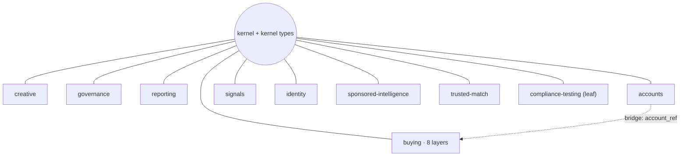
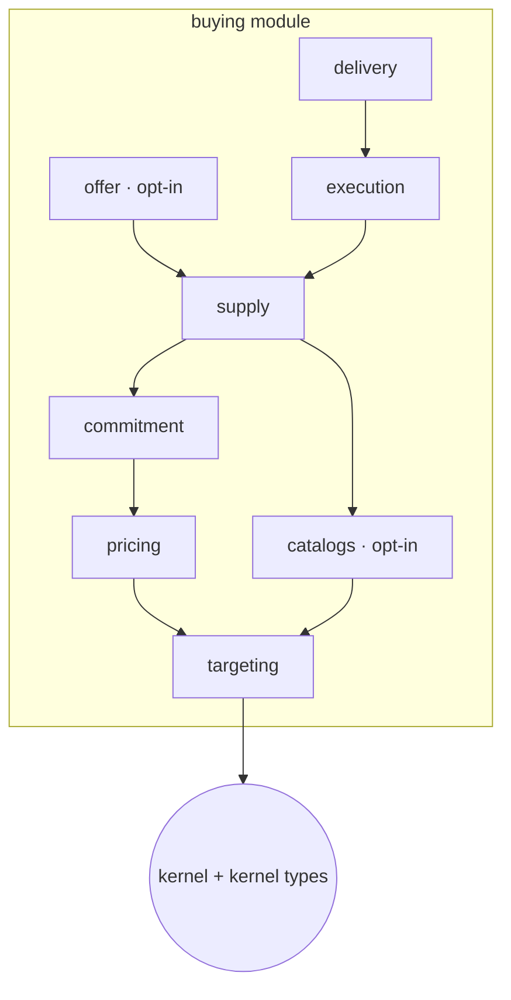
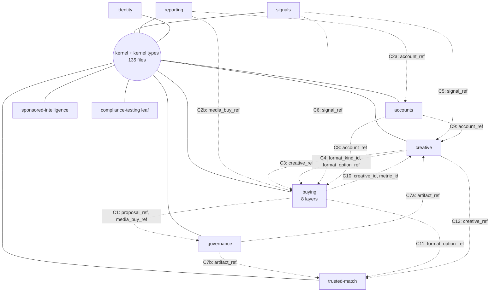

<Warning>
**Discussion draft. Not for merge.** This page illustrates a proposal to the working group (WG) for the Ad Context
Protocol (AdCP). It changes no schema, task, or normative text. Comment on the request for comments (RFC) issue, or
raise it in a WG session.
</Warning>

## Executive summary

**The question.** How does AdCP take seller allowances and make-goods (#8102), rate cards (#7955),
and further pricing models without adding to core every time?

**The answer.** This proposal does three things, in order:

1. **Layers.** Rearrange the schemas so that each layer depends only on the layers below it, never on
   a layer above. That gives the protocol encapsulation.
2. **Modules.** With encapsulation, each module owns its schemas and decides where extensions attach.
3. **Extensions.** Each extension's vocabulary arrives as a JSON Schema file, wrapped in an envelope
   and versioned by its digest. It attaches only where a module allows.

This gives two results:

- **Less churn between releases.** Each module changes on its own and owns its own lists, such as its
  error codes.
- **Features land in modules and extensions, not in the core.** The core stays stable.

It costs nothing on the wire, and the software development kit (SDK) experience gets better, not
worse:

- **No existing payload changes a byte.** 3.4 adds optional fields only, and each one appears only
  when the parties use it:
  - `understood_extensions` on requests, and `declared_extensions` in `get_adcp_capabilities`;
  - `extensions` on `commercial_terms`, on pricing options, and on hold entries;
  - `extensions_state` on each media buy in `get_media_buys`;
  - the `modules` map in `get_adcp_capabilities`, which holds standard modules and buying layers only;
  - extension branch IDs as `pricing_model` values, with the branch body in `extension_model`.
- **Extension data is a plain typed attribute.** The generated binding gives
  `proposal.commercial_terms.makegood_units`, and the core SDK package never changes.

The rest of this page follows this framing. [Part 1](#part-1-layers) is step 1, and
[Part 2](#part-2-modules-hooks-and-extensions) is steps 2 and 3. The [plan](#plan) runs 3.3, 3.4,
and 4.0. The [reference](#reference) holds every list, count, and file move, and shows how to
reproduce each number.

<Note>
**Presentation.** Two decks walk through the same design with the same examples: the **layering
deck** (Part 1) and the **modules and extensions deck** (Part 2). To view them, check out the branch
of this pull request (PR), and open `examples/modular-extensions/presentation/index.html` in a browser. Sections on this page name the
matching slides by number and title.
</Note>

### One example and four terms

A brand buys two sponsored videos from a creator. It pre-agrees one free replacement within 30 days,
with the same creator on the same platform. Without extensions, signing that rule needs added core
fields. With an extension, the values travel as one entry in the proposal's terms.

This page uses four terms. The following diagram shows where the make-good fields go in the
`refine_proposals` finalize response:

```text
proposals[0].commercial_terms   <- host object: the JSON object being extended
  .extensions                   <- extension point: the array that a module declares on that object
    [0]                         <- entry: one extension's { uri, digest, data }
      .data                     <- the extension's fields

proposal.commercial_terms.makegood_units   <- attribute: the typed SDK property that the
                                              generated binding makes from the entry
```

The following example shows the host object on the wire. The lines marked `+` are what the extension
adds, and every other line is today's payload, byte for byte:

```diff
  {
    "brand": { "domain": "brand.example.com" },
    "purchases": …,
    "start_time": "2027-03-10T17:00:00Z",
    "end_time": "2027-03-31T17:00:00Z",
    "total_budget": { "amount": 24000, "currency": "EUR" },
+   "extensions": [
+     {
+       "uri": "https://extensions.adcontextprotocol.org/makegood-units",
+       "digest": "sha256:0debf79a7390…",
+       "data": {
+         "rules": [
+           …,
+           {
+             "rule_id": "mg_video_2",
+             …,
+             "max_units": 1,
+             "window": { "interval": 30, "unit": "days" },
+             "keep_same": ["creator", "platform"],
+             …
+           }
+         ]
+       }
+     }
+   ]
  }
```

The host schema, `media-buy/commercial-terms.json` in buying's commitment layer, declares the extension
point:

```json
"items": { "$ref": "/schemas/core/extension-entry.json" },
…,
"x-adcp-extension-point": { "name": "commercial_terms", "must_understand": "always", "order": "uri" },
```

The buyer agent reads a plain attribute (Python binding demo, `buyer_agent.py`, line 36):

```python
        makegood = proposal.commercial_terms.makegood_units
```

_The entry is signed with the rest of the terms._

---

## Part 1: Layers

Part 1 is step 1: rearrange the schemas into layers without changing a payload.

### What are the layers?

The proposal gives the protocol four kinds of layer. Each one depends only on the layers beneath it.

- **The kernel layer** holds the transaction lifecycle, the protocol envelope, errors, idempotency,
  version negotiation, and the shared IDs and value formats: 135 files.
- **Standard modules** sit around the kernel: buying, creative, governance, reporting, accounts,
  signals, identity, sponsored-intelligence, and trusted-match. Each module references only the
  kernel layer by `$ref`, so the modules form a star.
- **Buying's layers** split the largest module. Each layer references only the kernel layer and the
  layers below it.
- **References by ID** connect modules. A module names another module's object by a kernel ID type,
  such as `account_ref`, and never references its schema by `$ref`.

Every transaction runs the same eight phases, and the kernel owns them:
`identify → discover → offer → commit → execute → change → report → close`. Modules own what happens
inside each phase. For example, buying owns `request_proposals` in offer and
`get_media_buy_delivery` in report.



Solid lines are the only `$ref` dependencies. The dashed arrow is a **bridge**: a feature that
combines two modules. The Bridge tab in [How does the protocol get there without changing the
wire?](#how-does-the-protocol-get-there-without-changing-the-wire) explains how a bridge keeps the
payload. The layout has 14 bridges.

Inside buying, the layers depend only downward:



Offer and execution are siblings. Both commit through the same supply-layer commit response, and
neither refers to the other. Each layer carries its own version, so a seller that doesn't negotiate
proposals leaves offer undeclared.

**In the decks:** layering deck, slide 3, "A kernel at the center, standard modules around it,
extensions at the edge", and slide 5, "Buying is one module with eight layers that depend only downward".

### Why does the protocol need them?

Today any schema can reference any other, and everything ships under one version. So one change
spreads across many areas, and every implementer sees every release.

- **One version for everything.** 1,047 schema files ship as one unit. From v2.5.1 to v3.2.5, the
  version moved 65 times, and every implementer saw all 65.
- **No boundaries.** 136 `$ref` references cross from one functional area into another.
- **Shared lists collect every area's changes.** `enums/error-code.json` changed in 93 commits in
  12 months.

**Example.** Revenue-share pricing (#6095) added one pricing model. It edited 12 schema files in 8
areas. With layers, the change needs hand edits in buying's pricing layer only. For details, see
[#6095 lands in one layer](#6095-lands-in-one-layer). Over the same history, layers leave a governance
implementer 11 of the 65 releases to track.

**In the decks:** layering deck, slide 2, "The protocol has no layers, so one change ripples across many areas".

### How does the protocol get there without changing the wire?

Four fixes remove all 136 crossing references. Each fix keeps every payload's bytes, and 3.4 lands all
four at once.

<Tabs>
<Tab title="Re-type to a kernel ID">

A field that names another module's object gets a kernel ID type or a kernel core. The owning
module registers its known values, and the build composes them back into the published schema. The
field accepts exactly what it accepted before. **58 crossings.**

**Example.** Kernel types' `brand_kit_override.logo` refers to creative's image asset. 3.4 types it
with the kernel `media_asset` core instead. The prototype's patch in `core/patches.json` reads:

```json
{
  "op": "compose",
  "file": "core/brand-ref.json",
  "pointer": "/properties/brand_kit_override/properties/logo",
  "ref": "/schemas/core/assets/image-asset.json",
  "fix": "media_asset"
}
```

</Tab>
<Tab title="Bridge">

A feature that combines two modules becomes a bridge extension. **50 crossings.**

**Example.** Buying's media buys embed the accounts format in `account`. Buying's execution layer
marks that property as a bridge point with `x-adcp-bridge-point`, which names the bridge C8,
`account-details-on-buys`. The prototype's patch on `get-media-buys-response.json` in
`core/patches.json` reads:

```json
{
  "op": "add",
  "file": "media-buy/get-media-buys-response.json",
  "pointer": "/properties/media_buys/items/properties/account/x-adcp-bridge-point",
  "value": {"bridge": "C8", "extension": "account-details-on-buys"},
  "fix": "C8"
}
```

A bridge works at build time, not on the wire, in three steps:

1. The property keeps its `$ref` to accounts' `core/account.json`, and the layering check counts that
   `$ref` as the bridge's, not buying's.
2. The 3.4 build composes the published host schema from the bridge, under the same property name,
   `account`.
3. On the wire, `media_buys[0].account` is today's account object. A bridge never uses the
   `extensions` envelope.

So only the bridge depends on both modules, and the payload stays the same.

</Tab>
<Tab title="Move with an alias">

A definition moves to the module that owns it. Its pre-3.4 `$id` stays as a generated alias, so
every reference to that `$id` still resolves. **23 crossings.**

**Example.** The `#signal` branch of buying's `core/wholesale-feed-event.json` describes a signal
listing. 3.4 publishes it as a signals schema, and the definition at its pre-3.4 location aliases it.

</Tab>
<Tab title="3.x compatibility assembly">

Legacy formats whose cross-module `$ref` references go away with the slated 4.0 removals sit in the
3.x compatibility assembly, beside the generated capabilities assembly. 4.0 removes it. **5 crossings.**

**Example.** The legacy `get_products` product embeds signal listings. The prototype's
`core/placement.json` puts it in the compatibility assembly:

```json
"core/product.json": {
  "layout_label": "module:buying/supply",
  "why": "legacy get_products product (products[] of the get_products facade); its included_signals[] embeds signal listings; slated for removal in 4.0 with the 3.x compatibility facades"
},
```

</Tab>
</Tabs>

The four fixes add up to 136 (58 + 50 + 23 + 5). 3.4 also adds 12 kernel types, all IDs or cores.
It publishes 695 files under namespaced `$id` values, with their pre-3.4 `$id` values as aliases.
None of this changes a payload.

**In the decks:** layering deck, slide 7, "Four byte-preserving fixes remove all 136 crossing references".

### How does it stay that way?

A layering check runs three tests on every `$ref`:

- **Star:** A module references only the kernel layer.
- **Layers:** A buying layer references only the kernel layer and the layers below it.
- **Acyclic:** The graph of the kernel layer, the modules, the buying layers, and the extensions has
  no cycle.

The check is blocking from the release that introduces it. It has no baseline and no report-only
phase.
The 3.x compatibility formats are an assembly, not an exception.

**Example.** The prototype runs the same check on the 454 schema files of its vendored subset. Upstream breaks the
rules at 45 places in that subset, and the 3.4 fixes leave 0. A test adds one module-to-module `$ref`
and checks that the build fails.

**Zero violations, enforced in continuous integration (CI), from 3.4.**

---

## Part 2: Modules, hooks, and extensions

Part 2 is steps 2 and 3: what a module owns, where it lets extensions attach (its **hooks**), and how
an extension attaches.

### What is a module, and how does it release on its own?

A standard module is one versioned unit. It bundles its schemas, its tasks, its block in
`get_adcp_capabilities`, and the extension points it declares. It has its own version and a frozen
digest, and it names other modules only by kernel IDs.

Because no other module references its schemas by `$ref`, a module can release alone. The prototype
shows this with a real run. It releases buying/pricing 1.1, which adds one optional property,
`base_spot_length_seconds`, to the cost-per-point (`cpp`) pricing option. The build updates the
version and digest of one layer:

```text
core/release.json after the re-stamp: 1 of 22 layers changed
  buying/pricing           1.0  sha256:9867a778b956…  ->  1.1  sha256:13f069e1766a…
  core                     3.3  sha256:3f8ca048231a…  =  unchanged
  kernel-types             3.3  sha256:e50cd6e3609f…  =  unchanged
  governance               1.0  sha256:f24c37db3831…  =  unchanged
  buying/commitment        1.0  sha256:4910acbb2ae8…  =  unchanged
  … 17 more layers unchanged
  bundle_digest            sha256:26d4e59152ab…  ->  sha256:88cc4a64caaa…  (it hashes every layer)
```

Every extension keeps its digest, and an app that uses only governance doesn't change:

```text
apps regenerated (npm run sdk):
  test/apps/governance-only  pins core, kernel-types, governance: adcp.lock.json and adcp-sdk/ byte-identical
  examples/buyer-app         pins the whole bundle: 3 files changed (adcp-sdk/GENERATED.json, adcp-sdk/bindings.ts, adcp.lock.json)
```

A minor release must pass an additive check. The build refuses the same field when it's required:

```text
REFUSED: buying/pricing 1.1 is not additive; a change like this needs buying/pricing 2.0, served beside 1.x
```

Three rules keep versions accurate. The build fails with `LAYER MOVED` when a layer's files change
without a release of that layer. A module's major release serves the prior major version in parallel.
A `0.x` module is experimental and can break with notice.

**How buyers and sellers agree on versions.** A seller lists its modules and buying layers in one
optional `modules` map in `get_adcp_capabilities`. Extensions don't appear there; they stay in
`declared_extensions`. The creator network in the prototype lists the six buying layers it implements:

```json
{
  …,
  "adcp": { "major_versions": [3], "idempotency": { "supported": true, "replay_ttl_seconds": 86400 } },
  "supported_protocols": ["media_buy"],
  "modules": {
    "buying/commitment": { "version": "1.0", "digest": "sha256:4910acbb2ae8…" },
    "buying/execution": { "version": "1.0", "digest": "sha256:1bb0acbd1b86…" },
    "buying/offer": { "version": "0.1", "digest": "sha256:88b4f306eeef…" },
    "buying/pricing": { "version": "1.0", "digest": "sha256:9867a778b956…" },
    "buying/supply": { "version": "1.0", "digest": "sha256:d7fc6bea6c36…" },
    "buying/targeting": { "version": "1.0", "digest": "sha256:03f992ef0b5e…" }
  },
  …,
  "declared_extensions": …
}
```

The buyer's SDK checks each entry against the versions that its lock file pins. A different minor
version is compatible. For a different major version or a missing `buying/offer`, the SDK refuses
`request_proposals` before the call (`MODULE_MAJOR_MISMATCH`, `MODULE_NOT_OFFERED`).

A release is a bundle. One release number resolves to the kernel version and one version per module,
buying layer, and extension. A seller configures one number, and the SDK resolves the rest. SDKs can
also ship one package per module behind today's package names _(proposed)_.

**In the decks:** modules and extensions deck, slide 21, "A module ships a release without moving the
kernel or any other module", and slide 22, "Buyers and sellers negotiate module versions, and SDKs ship
one package per module".

### How does a module open hooks?

A **hook** is a place where a module lets extensions attach. The kernel defines what a hook looks
like, and each module decides where its hooks go. Hooks come in three kinds:

- **An extension point** (`x-adcp-extension-point`) on a property the module owns. Extensions put
  entries in that property. For example, buying's commitment layer declares `commercial_terms`.
- **An open union** (`x-adcp-open-union`): a discriminated field that the module opens to extensions.
  An extension adds a **branch**, one more variant, named by a branch ID `<uri>#<branch>`. Its body is
  an entry. For example, buying's pricing layer declares the `pricing_model` union.
- **The task union.** The kernel declares one generic `task` union, and an extension adds a task as
  one more branch. For example, `makegood-units` adds `request_makegood`.

A bridge point (`x-adcp-bridge-point`) isn't a hook. It belongs to the layering fixes in Part 1 and
carries no extension data.

### Where exactly a module marks an extension point

A module marks an extension point in its own schema file, on the property that carries the entries.
In the prototype, buying's commitment layer adds `extensions` to `commercial_terms`. The following
patch comes from `core/patches.json`:

```json
{
  "layer": "buying/commitment",
  "role": "module layer",
  …
  "patches": [
    {
      "op": "add",
      "file": "media-buy/commercial-terms.json",
      "pointer": "/properties/extensions",
      "value": {
        "type": "array",
        "items": {"$ref": "/schemas/core/extension-entry.json"},
        "minItems": 1,
        "x-adcp-extension-point": {"name": "commercial_terms", "must_understand": "always", "order": "uri"},
        "description": "Binding extension data…"
      }
    },
    …
  ]
}
```

The patch sets the following location and marker:

- **File:** `media-buy/commercial-terms.json`, built to `core/schemas/media-buy/commercial-terms.json`.
- **JSON pointer:** `/properties/extensions`.
- **Annotation:** `x-adcp-extension-point`, named `commercial_terms`, with policy `always`.

An extension asks to attach there in its manifest, `packages/ext-makegood-units/extension.json`:

```json
{ "point": "commercial_terms", "definition": "MakegoodTerms", … }
```

On the wire, the entry then sits at host object → `.extensions` → `[0]` → `.data`:
`proposals[0].commercial_terms.extensions[0].data`.

The module sets one of three must-understand policies on each extension point:

| Policy | What a receiver without the extension does | Example |
|---|---|---|
| `always` | Rejects. The data is binding. | `commercial_terms` (signed terms) |
| `flag` | Rejects only if the entry's own `must_understand` is true; otherwise ignores it. | `pricing_option` |
| `never` | Ignores the entry. | `media_buy_state`, carried in `extensions_state` (readback) |

The prototype declares the following hooks in buying:

| Layer | Hook | File | JSON pointer |
|---|---|---|---|
| buying/pricing | extension point `pricing_option`, policy `flag` | `pricing-options/cpm-option.json`, `pricing-options/cpp-option.json`, `pricing-options/extension-option.json` | `/properties/extensions` |
| buying/pricing | open union `pricing_model` | `pricing-options/extension-option.json`, `core/canonical-pricing-option.json` | `/x-adcp-open-union` |
| buying/commitment | extension point `commercial_terms`, policy `always` | `media-buy/commercial-terms.json` | `/properties/extensions` |
| buying/execution | extension point `media_buy_state`, policy `never` | `media-buy/get-media-buys-response.json` | `/properties/media_buys/items/properties/extensions_state` |

The kernel declares two hooks of its own in `core/extension-declaration.json`: the `capabilities`
extension point and the `task` union.

**Adding a hook is an additive minor release of that one module.** For example, an extension point
on another execution-layer object is buying/execution 1.1. The kernel and every other module and layer
keep their versions and digests.

**In the decks:** modules and extensions deck, slide 20, "A module decides where extensions attach".

### What is an extension, and how does it attach?

**Goal:** let an external JSON Schema file add fields to a specific part of a core message, without
changing core.

**The envelope.** The kernel adds no fields for features. Fields that describe advertising, such as
budget, make-goods, pricing, and formats, live in modules and extensions. The kernel adds only what it
needs to carry data it can't understand:

- `uri`: which definition;
- `digest`: which exact version, so signed terms can't change underneath either party;
- `data`: the fields, which the kernel never reads;
- the must-understand rule: whether a receiver without the definition rejects the entry or ignores it.

Two small parts go with them: the marker a module uses to declare a hook, and the seller's and
buyer's declaration lists (`declared_extensions`, `understood_extensions`). Everything else about an
extension lives in the external file that `uri@digest` points to.

**The kernel defines the envelope once. Each extension defines what goes inside.**

**Why an envelope:** plain JSON Schema can't validate fields that another file defines without
changing the core file. The envelope keeps core untouched, stops field-name collisions between
extensions, and says exactly which schema checks the data.

**The four steps.** Every extension works through the same four steps:

<Steps>
  <Step title="① Mark the extension point">
    The module marks the extension point: it adds `x-adcp-extension-point` to a property it owns, with
    a must-understand policy.
  </Step>
  <Step title="② Write the external file">
    The author writes the external schema file, with a manifest that says "attach at `commercial_terms`".
  </Step>
  <Step title="③ Wrap in the envelope">
    The sender wraps the fields in the envelope `{uri, digest, data}`. Both sides declare support
    first.
  </Step>
  <Step title="④ Validate in two passes">
    The receiver validates in two passes. Core validates everything except `data`. Then the extension's
    file validates `data`, and the extension's rules run. A receiver without the file rejects the entry
    inside signed terms and can ignore it elsewhere.
  </Step>
</Steps>

**Negotiation.** The seller declares the extension in its `get_adcp_capabilities` response:

```json
{
  …,
  "declared_extensions": [
    …,
    {
      "uri": "https://extensions.adcontextprotocol.org/makegood-units",
      "digest": "sha256:0debf79a7390…",
      "points": ["commercial_terms", "media_buy_state", "task"],
      "tasks": [
        { "name": "x_request_makegood", "task": "https://extensions.adcontextprotocol.org/makegood-units#request_makegood" }
      ]
    }
  ]
}
```

The buyer's SDK lists what the buyer understands on each request, in this example
`request_proposals`. The lines marked `+` are what the extension adds:

```diff
  {
    "idempotency_key": "slides-journey-request-0001",
    "brief": "Two sponsored YouTube integrations with a cooking creator in March",
    "brand": { "domain": "brand.example.com" },
+   "understood_extensions": [
+     { "uri": "https://extensions.adcontextprotocol.org/makegood-units", "digest": "sha256:0debf79a7390…" }
+   ]
  }
```

The match is exact: the same `uri` and the same `digest`. A buyer that lists nothing never receives the entry. The
seller projects the terms without it, or declines. A seller that sends the entry anyway fails the
buyer's check:

```json
{
  "code": "EXTENSION_NOT_UNDERSTOOD",
  "errors": [
    {
      "code": "EXTENSION_NOT_UNDERSTOOD",
      "path": "/proposals/0/commercial_terms/extensions/0",
      "message": "https://extensions.adcontextprotocol.org/makegood-units@sha256:0debf79a7390… is must-understand at commercial_terms…"
    }
  ]
}
```

**Where the rules live.** An extension's rules can't live in JSON Schema alone. Each package carries a
spec with numbered rules, conformance storyboards that cite the rule IDs, and reference code. The
digest pins all of them, so one `uri@digest` gives the buyer SDK, the conformance runner, and the
reviewer the same rules. For example, [MG-R9](https://github.com/adcontextprotocol/adcp/blob/proposal/modular-adcp/examples/modular-extensions/packages/ext-makegood-units/spec.md#mg-r9-at-most-max_units-per-rule) (at most `max_units` units
per rule) is a spec rule that a storyboard step checks.

**In the decks:** modules and extensions deck, slide 7, "The kernel defines the envelope once; each
extension defines what goes inside", and slide 8, "Every extension works through the same four steps".

### What does a developer do?

A developer says: "Here is the AdCP task I want to extend. I want to (a) add parameters to a standard
task's request or response, or (b) add a task: a Model Context Protocol (MCP) tool or an Agent2Agent
(A2A) skill." Both cases follow the same six steps, which the following table compares, and touch
only the extension package.

| Step | (a) Add parameters: make-good rules in the proposal's `commercial_terms` (`refine_proposals` finalize response) | (b) Add a task: `request_makegood` |
|---|---|---|
| 1 The target payload | `proposals[0].commercial_terms.extensions[0]` carries one entry | capabilities map `x_request_makegood` to a task ID; the call and its response |
| 2 Declare it | `schema.json` (`MakegoodTerms`), manifest point `commercial_terms`, spec rules, storyboards | `schema.json` (`MakegoodRequest`, `MakegoodResponse`), manifest point `task`, spec rules, storyboards |
| 3 Why nothing else changes | buying's commitment layer declared the extension point once | the kernel declared the task union once |
| 4 Negotiation on the wire | `declared_extensions` and `understood_extensions`, exact `uri@digest` | the same, plus `tasks[]`: transport name to task ID |
| 5 Generated code | one line in `adcp.config.json`, then `npm run sdk`: `CommercialTerms` gets `makegood_units?: MakegoodTerms` | the same line and command: `Tasks.request_makegood`, `Client.requestMakegood(request)`, and a typed `Server` |
| 6 Use it in the sales agent and the buyer agent | the seller sets `terms.makegood_units`; the buyer reads it | the seller writes `server.handle('request_makegood', handler)`; the buyer calls `client.requestMakegood(request)` |

Step 3 holds for both cases. In the prototype's run, a buyer and a seller enable `makegood-units` and
call `request_makegood`. Every one of the prototype's 22 frozen layer digests stays the same, and the
installed core SDK package stays byte-identical.

**The generated binding.** The app lists its extensions in `adcp.config.json` and runs one command.
The command writes the app's own typed layer, in which extension data is a plain attribute. The wire
stays the envelope, and nothing changes or rebuilds the core package.

<Tabs>
<Tab title="(a) Add parameters">

The app declares its extensions in `examples/buyer-app/adcp.config.json`:

```json
{
  "core": "3.3.0",
  "extensions": {
    "seller_adjustable_terms": "https://extensions.adcontextprotocol.org/seller-adjustable-terms@^1",
    "makegood_units": "https://extensions.adcontextprotocol.org/makegood-units@^1"
  },
  …
}
```

One command generates the typed layer (`examples/buyer-app/adcp-sdk/types.ts`, line 12):

```ts
/** commercial_terms (extension point, must_understand always, in /schemas/media-buy/commercial-terms.json). Wire: extensions[]. */
export type CommercialTerms = Omit<core.CommercialTerms, 'extensions'> & {
  /** makegood-units 1.5.0 (sha256:0debf79a7390…), definitions.MakegoodTerms */
  makegood_units?: makegood_units.MakegoodTerms;
  /** seller-adjustable-terms 1.6.0 (sha256:41d05441540d…), definitions.SellerAdjustableTerms */
  seller_adjustable_terms?: seller_adjustable_terms.SellerAdjustableTerms;
};
```

The sales agent sets a plain attribute (`examples/sales-agent/agent.ts`, lines 60 to 62):

```ts
    const terms: CommercialTerms = { brand: { domain: 'brand.example.com' }, purchases: [first, second], start_time: first.start_time, end_time: second.end_time };
    // A plain attribute; the layer writes the envelope { uri, digest, data } for this exact digest.
    if (makegoods) terms.makegood_units = { rules: [rule(0), rule(1)] };
```

The buyer agent reads it (`examples/buyer-app/app.ts`, line 53). `rules[0]` is the rule for video 1:

```ts
  const cap = terms.makegood_units?.rules[0].max_units ?? 0; // free units for video 1, from the make-good rule
```

</Tab>
<Tab title="(a) In Python">

The Python binding demo generates the same layer from the same kind of config:

```text
$ python -m adcp_codegen examples/my_agent/adcp.config.json
adcp_codegen: wrote adcp_types/ (14 files; envelope; extensions: makegood-units 1.5.0, seller-adjustable-terms 1.6.0)
```

The generated class subclasses the SDK's own class and adds one attribute per extension
(`adcp_types/commercial_terms.py`):

```python
class CommercialTerms(_sdk.CommercialTerms):
    """``adcp.types.domains.media_buy.commercial_terms.CommercialTerms`` plus one attribute per enabled extension."""

    makegood_units: MakegoodTerms | None = None
    """makegood-units 1.5.0 (sha256:0debf79a7390...). Wire: the extensions entry with this uri and digest."""
    seller_adjustable_terms: SellerAdjustableTerms | None = None
    """seller-adjustable-terms 1.6.0 (sha256:41d05441540d...). Wire: the extensions entry with this uri and digest."""
    …
```

The sales agent sets it (`sales_agent.py`, line 82):

```python
        makegood_units=MakegoodTerms(rules=[makegood_rule(0), makegood_rule(1)]),
```

</Tab>
<Tab title="(b) Add a task">

The seller declares the task in its capabilities, as the negotiation example in
[What is an extension, and how does it attach?](#what-is-an-extension-and-how-does-it-attach) shows.
The manifest registers one branch of the kernel's task union (`packages/ext-makegood-units/extension.json`):

```json
{
  …,
  "requires": { …, "points": { "commercial_terms": 1, "media_buy_state": 1, "task": 1 } },
  "extends": [
    …,
    { "point": "task", "branch": "request_makegood", "definition": "MakegoodRequest", "response": "MakegoodResponse", … }
  ],
  …
}
```

The buyer calls the transport name that the seller declared, `x_request_makegood`. The request is the
whole `MakegoodRequest`:

```json
{
  "media_buy_id": "mb_3",
  "rule_id": "mg_video_2",
  "package_id": "pkg_video_2",
  "reason": "deliverable_missed",
  "idempotency_key": "slides-makegood-0001"
}
```

The request has no envelope, because nothing in it belongs to core. The whole request and response
are the extension's own schemas. The task ID in the seller's capabilities already names the exact
`uri@digest`, so the transport name tells the seller which schema checks the call. Rule
[MG-R18](https://github.com/adcontextprotocol/adcp/blob/proposal/modular-adcp/examples/modular-extensions/packages/ext-makegood-units/spec.md#mg-r18-the-seller-declares-the-task-and-the-buyer-calls-the-declared-name) (the seller declares the task, and the buyer calls the declared
name) covers this.

The same config line and command generate a typed handler and a typed client method
(`examples/sales-agent/adcp-sdk/types.ts`, line 54):

```ts
/** The tasks this app's extensions contribute: request and response types from each extension's schema. */
export interface Tasks {
  /** makegood-units 1.5.0: task id https://extensions.adcontextprotocol.org/makegood-units#request_makegood */
  request_makegood: { request: makegood_units.MakegoodRequest; response: makegood_units.MakegoodResponse };
}
```

The sales agent handles the task (`examples/sales-agent/agent.ts`, line 85):

```ts
// The contributed task: request and response types come from the extension's schema.
server.handle('request_makegood', (req) => {
  const buy = buys.get(req.media_buy_id);
  if (!buy) throw new SellerRejection('MEDIA_BUY_NOT_FOUND', req.media_buy_id);
  const rule = buy.accepted_proposal.commercial_terms.makegood_units?.rules.find((r) => r.rule_id === req.rule_id);
  const ledger = buy.makegood_units; // this extension's readback ledger, a plain attribute
  …
```

The buyer agent calls it (`examples/buyer-app/app.ts`, line 91):

```ts
// request_makegood is a typed method of this app's client: one method per task its extensions contribute.
const request = { media_buy_id, rule_id: 'mg_video_2', package_id: 'pkg_video_2', reason: 'deliverable_missed' } as const;
const answer = await client.requestMakegood({ ...request, idempotency_key: 'makegood-0001-aaaaaaa' });
```

The task ID `<uri>#request_makegood` carries no digest, so code that names the task survives a
digest change. The seller chooses the transport name, and the `x_` prefix keeps contributed names
apart from module tasks. The Python demo doesn't generate contributed tasks.

</Tab>
</Tabs>

**At a real seller boundary.** The same generated binding runs in a scratch branch of the Prebid sales
agent's `create_media_buy`. That agent has no proposal flow, so the test attaches one `MakegoodRule`
per package at a test-only extension point that the layout doesn't declare:

```text
create_media_buy request -> packages[0] (host object) -> .extensions (test-only point) -> [0] -> .data = one MakegoodRule
SDK attribute: package.makegood_units
```

Every transport (MCP, A2A, REST) and `validated_request` stay unchanged. The one change at the
boundary imports the request data transfer object (DTO) from the app's generated layer. In all, the
change touches 7 files and adds 5. The sales agent's 6,513 unit tests pass. The example shows the
boundary pattern; the host doesn't matter.

**In the decks:** modules and extensions deck, slide 9, "You add parameters or a task in the same six
developer steps", and slide 17, "(b) Steps 3–4: the kernel's task union absorbs the task, and each
seller names its tool".

### Worked examples

Each example answers the question from the executive summary for one real change. The two creator examples share one
buy: `proposal_id: "prop_2"`, two videos in March 2027, with both extensions in one
`commercial_terms.extensions` list. Each event carries its lifecycle phase.

#### #8102: seller-adjustable terms and make-goods

**Use case.** A brand buys two sponsored YouTube videos from a cooking creator in March. Before video
1 goes live, the creator falls ill. The brand pre-agreed that the seller may move each video up to 7
days later, with 48 hours' notice. Later the creator can't make video 2. The brand pre-agreed one free
replacement within 30 days, with the same creator on the same platform.

**Why core can't express it.** `commercial_terms` is closed (`additionalProperties: false`). It
has neither seller allowances nor make-good caps. #8102 adds `seller_adjustable_terms` to core and
edits 16 core schema files.

**What goes where.** The mechanism both sides run stays in buying. The vocabulary that varies by
market ships as extensions:

| Part of #8102 | Where it lives | Why |
|---|---|---|
| Seller offers: `proposal_initiator`, `offer_reason`, successor proposals | buying's offer layer (module) | a mechanism both sides run |
| Allowance kinds: `time_shift`, `decrease`, `alternates` | `seller-adjustable-terms` 1.6.0 (extension) | market vocabulary |
| Make-good caps | `makegood-units` 1.5.0 (extension) | market vocabulary |

**The make-good, payload first.** The `refine_proposals` finalize response (offer phase) carries the
rule. The host object is `proposals[0].commercial_terms`, the extension point is `.extensions`, the
entry is `[0]`, and the fields are in `.data`:

```json
{
  "proposals": [
    {
      "proposal_id": "prop_2",
      …,
      "proposal_status": "committed",
      …,
      "commercial_terms": {
        …,
        "extensions": [
          {
            "uri": "https://extensions.adcontextprotocol.org/makegood-units",
            "digest": "sha256:0debf79a7390…",
            "data": {
              "rules": [
                …,
                { "rule_id": "mg_video_2", "purchase_index": 1, "trigger": "deliverable_missed", "max_units": 1, "window": { "interval": 30, "unit": "days" }, "keep_same": ["creator", "platform"], "at_no_cost": true }
              ]
            }
          },
          …
        ]
      },
      …
    }
  ]
}
```

The four steps answer four questions about this payload:

1. **① Where?** `commercial_terms.extensions`, which buying's commitment layer declares with policy
   `always`; see [Where exactly a module marks an extension point](#where-exactly-a-module-marks-an-extension-point).
2. **② Which extension?** `uri` and `digest` name `makegood-units` 1.5.0. Its manifest says
   `"point": "commercial_terms"`.
3. **③ What are these fields?** The extension's `MakegoodRule`. `window` reuses the kernel's `Duration`.
4. **④ Who checks them?** Core validates the terms except `data`. Then the extension validates `data`
   and runs its rules, such as [MG-R9](https://github.com/adcontextprotocol/adcp/blob/proposal/modular-adcp/examples/modular-extensions/packages/ext-makegood-units/spec.md#mg-r9-at-most-max_units-per-rule) (at most `max_units` units per
   rule). A buyer without the extension gets `EXTENSION_NOT_UNDERSTOOD`.

In the SDK, the buyer reads `proposal.commercial_terms.makegood_units`. _The entry is signed with the
rest of the terms._

When the creator misses video 2 (change phase), the buyer calls `request_makegood`. The seller issues
unit `mg_8` at revision 3, change `chg_7`. A second request under the same rule, with a different
idempotency key, gets `CAP_EXCEEDED`: [MG-R20](https://github.com/adcontextprotocol/adcp/blob/proposal/modular-adcp/examples/modular-extensions/packages/ext-makegood-units/spec.md#mg-r20-a-request-cannot-exceed-the-cap) (a request can't exceed the cap). The
readback (report phase) shows the unit at `media_buys[0].extensions_state[0].data.issued[0]`.

**The slip: the same extension point, a second extension.** Compared with the make-good, only the
extension and its fields differ:

- At ① the point is the same: the slip is the second entry, `extensions[1]`, in the same list.
- At ② the entry names `seller-adjustable-terms` 1.6.0.
- At ③ the fields are allowances, each with a `TimeShiftConstraint`.
- At ④ the rules differ, as the readback shows.

```json
{
  "uri": "https://extensions.adcontextprotocol.org/seller-adjustable-terms",
  "digest": "sha256:41d05441540d…",
  "data": {
    "allowances": [
      …,
      {
        "allowance_id": "slip_v1_start",
        "purchase_index": 0,
        "path": "/start_time",
        "constraint": { "kind": "time_shift", "direction": "later", "max_shift": { "interval": 7, "unit": "days" } },
        "min_notice": { "interval": 48, "unit": "hours" }
      },
      …
    ]
  }
}
```

The SDK attribute is `proposal.commercial_terms.seller_adjustable_terms`. The seller moves video 1 by 5
days (change phase: `chg_4`, revision 2). Rule [SAT-R11](https://github.com/adcontextprotocol/adcp/blob/proposal/modular-adcp/examples/modular-extensions/packages/ext-seller-adjustable-terms/spec.md#sat-r11-bounds-count-from-the-accepted-value) (bounds
count from the accepted value) decides what happens next. When the seller then shifts it 4 more days,
the buyer's SDK reports the second shift on readback:

```text
adj_10 (allowance slip_v1_start): moved 9 days from the accepted value; allowance max is 7 days
```

**Size.** #8102 changes 16 core schema files. Each extension changes 0.

**In the decks:** modules and extensions deck, slide 25, "#8102 becomes two extensions on one signed
proposal", and slide 26, "Make-good, payload first: four callouts answer where, which, what, and who checks".

#### #7955: rate card and indexed CPP

**Use case.** A Dutch TV sales house quotes prime time at a cost per point (CPP), a price per rating
point. It wants to show how it built a quote of 2,050 from a base of 1,000 and its indices. It also
wants to sell early requests at a price that is only a ceiling, because it fixes the market index
after booking.

**Why core can't express it.** A typed card needs `pricing-options/price-adjustments.json` in
core (#7955). A price fixed after acceptance can't be core `cpp`, whose `fixed_price` binds at
acceptance. `pricing_model` is a closed enum.

**What goes where.** The quote stays in buying's pricing layer. The card and the indexed model ship as
two extensions with different must-understand rules:

| Part | Where it lives | At ① | At ④ |
|---|---|---|---|
| The quote: `fixed_price` and `price_breakdown` | buying/pricing (module) | – | binds |
| The rate card | `rate-card-index` 1.5.0 | the `pricing_option` extension point, policy `flag` | ignorable; fails closed only if flagged or signed |
| The indexed price | `linear-tv-indexed-cpp` 1.5.0 | a branch of the `pricing_model` open union | an unknown option drops; signed terms fail closed |

**The rate card, payload first.** The card travels next to the binding quote, in the `get_products`
response (discover phase). The host object is `products[0].pricing_options[0]`, the extension point is
`.extensions`, the entry is `[0]`, and the card is in `.data`:

```json
{
  "pricing_option_id": "po_prime_cpp_late",
  "pricing_model": "cpp",
  "currency": "EUR",
  "fixed_price": 2050,
  …,
  "extensions": [
    {
      "uri": "https://extensions.adcontextprotocol.org/rate-card-index",
      "digest": "sha256:a24ab2ac5282…",
      "data": {
        "base_price": 1000,
        "premium_basis": "indexed",
        …,
        "rows": [
          { "kind": "index", "name": "Your Time Vast", "dimension": "buying_option", "value": "vast", "factor": 2 },
          { "kind": "index_points", "name": "Preferred position", "dimension": "position", "value": "preferred", "points": 30, "target_dimension": "buying_option" },
          …
        ]
      }
    }
  ]
}
```

The host schema, `pricing-options/cpp-option.json` in buying's pricing layer, declares the point:

```json
"x-adcp-extension-point": { "name": "pricing_option", "must_understand": "flag" },
```

Compared with the make-good, the rate card differs at each step:

- At ① the point is `pricing_option` on a `cpp` pricing option, with policy `flag` instead of `always`.
- At ② the entry names `rate-card-index` 1.5.0.
- At ③ the fields are the card's rows. They rebuild the quote from the base of 1,000.
  The factors are 2 + 0.30 for the buying option and position, 1.1 for March, 0.75 for a 20-second
  spot, and 1.08 for the published market index. Rounded per row, the result is 2,050.
- At ④ a buyer without the extension ignores the card, and `fixed_price: 2050` binds. Rule
  [RC-R2](https://github.com/adcontextprotocol/adcp/blob/proposal/modular-adcp/examples/modular-extensions/packages/ext-rate-card-index/spec.md#rc-r2-the-quote-binds-not-the-card) (the quote binds, not the card) requires this.

The SDK attribute is `pricing_option.rate_card_index`.

**The indexed price, payload first.** The indexed price is a branch of the pricing union, and in the
signed terms it is the purchase pricing. The `refine_proposals` finalize response (offer phase) carries
it at `proposals[0].commercial_terms.purchases[0].pricing`:

```json
{
  "pricing_option_id": "po_prime_indexed_early",
  "currency": "EUR",
  "pricing_model": "https://extensions.adcontextprotocol.org/linear-tv-indexed-cpp#indexed_cpp",
  "extension_model": {
    "uri": "https://extensions.adcontextprotocol.org/linear-tv-indexed-cpp",
    "digest": "sha256:52f80ee6d7a3…",
    "data": {
      …,
      "base_price": 1000,
      …,
      "market_index": { "fixed_at": "2027-01-16T00:00:00+01:00", "floor": 0.8, "cap": 1 },
      …,
      "ceiling_price": 1898
    }
  }
}
```

Compared with the make-good, the indexed price differs at each step:

- At ① a branch of the `pricing_model` open union replaces the extension point. `pricing_model` holds
  the branch ID, and `extension_model` holds the entry.
- At ② the entry names `linear-tv-indexed-cpp` 1.5.0.
- At ③ the fields are the indexed model: a base price, indices, a market index, and a ceiling.
- At ④ a buyer without the extension drops the option from a product's list and keeps the others
  (`EXTENSION_OPTION_DROPPED`). Inside signed terms, the buyer rejects. Rule
  [LTV-R12](https://github.com/adcontextprotocol/adcp/blob/proposal/modular-adcp/examples/modular-extensions/packages/ext-linear-tv-indexed-cpp/spec.md#ltv-r12-the-rate-follows-from-the-index) (the rate follows from the index) checks the fixing.

The SDK attribute is `pricing.linear_tv_indexed_cpp`. After booking (change phase), the seller fixes
the index at 0.96. The readback carries `rate: 1822`, and the invoice (close phase) is 104.1 points at
1,822. A buyer that never listed the extension gets core `cpp` at the published index,
`fixed_price: 2050`.

**In the decks:** modules and extensions deck, slide 27, "#7955 becomes an ignorable rate card and a
pricing-union branch"; slide 28, "Rate card, payload first: a flag extension point, ignorable unless
signed"; and slide 29, "Indexed CPP, payload first: a branch instead of an extension point".

#### #6095 lands in one layer

**Use case, from the protocol's history.** On August 8, 2026, #6095 added revenue-share pricing. An
affiliate or commerce seller charges a commission on attributed sales. The option sits at
`products[0].pricing_options[i]` in the `get_products` response. The following option is from
`docs/media-buy/advanced-topics/pricing-models.mdx`:

```json
{
  "pricing_option_id": "affiliate_purchase_4pct",
  "pricing_model": "revenue_share",
  "event_type": "purchase",
  "event_source_id": "affiliate_attribution",
  "commission_rate": 0.04,
  "currency": "USD",
  "commission_basis_description": "Net merchandise value after discounts, excluding tax and shipping; returns removed before commission lock."
}
```

This isn't an extension: revenue share is a WG pricing model, so it is a known value of buying's open
`pricing_model` union. In the SDK it is a core class, `RevenueSharePricingOption.commission_rate`.

**Why it touched 8 areas.** `pricing_model` was a closed enum in shared types, and `core/pricing-option.json`
a closed `oneOf`. Delivery, product filters, the metric list, measurement terms, usage reporting, and
compliance testing each needed an edit: 12 files in 8 areas.

**In the layered design,** only buying's pricing layer needs hand edits, and the pricing-option
payload stays byte-identical:

- **By hand, in buying/pricing only:** The branch, the `contingent` pricing structure, and a
  pricing-filter fragment that supply composes.
- **Generated:** The known values of `pricing_model` and of the available-metric list, from the
  pricing layer's registry. The kernel-types source doesn't change.
- **Reported by metric ID:** Delivery reports `commissionable_value` as a `metric_values` row,
  not as the flat field that #6095 shipped. The response already defines that row type.

A WG pricing model is a known value of the module's open union. A market model, such as indexed CPP,
is an extension branch of the same union. The reference maps all 12 files.

**In the decks:** modules and extensions deck, slide 30, "In the modular design, revenue-share pricing
lands in one module layer".

---

## Plan

The plan is short because no existing payload changes. The following table lists what each release
ships.

| Release | What ships | Wire |
|---|---|---|
| 3.3 | The planned 3.3 fixes. No schema moves. Market vocabulary in flight stays out of closed core schemas: the rate card (#7955) and the allowance kinds (#8102) wait for the 3.4 extension points. | no change |
| 3.4 | The extension mechanism in the kernel. Extension points, open unions, and the task union, declared by their owners. The `modules` map. Every byte-preserving fix at once: 12 kernel types, re-types, 14 bridges, moves with aliases, and 695 namespaced `$id`s. Zero violations, enforced in CI. | optional fields only |
| 4.0 | The four slated removals and the 3.x compatibility assembly. 17 optional cleanups, each decided on its own merits. | 4 slated removals |

---

## Reference

<Note>
**Reference appendix.** This part holds the lists, counts, and file moves behind Parts 1 and 2. The
narrative doesn't depend on it. Paths to the analysis are relative to
`examples/modular-extensions/analysis/`. *Proposed* marks a design that the prototype doesn't run, and
*inference* marks a reading of the evidence that no script computes.
</Note>

### The transaction lifecycle

Every transaction runs through the following eight phases.

| Phase | What happens | Example tasks and events |
|---|---|---|
| identify | Establish the agent, the principal, and the account. | authentication, `account` references |
| discover | Learn capabilities, modules, extensions, and products. | `get_adcp_capabilities`, `get_products` |
| offer | Make an immutable offer with terms; a revision is a successor. | `request_proposals`, `refine_proposals` |
| commit | Accept the exact signed terms. | `accept_proposal`, `buy_products` |
| execute | The contract is in force. | the media buy and its packages run |
| change | Change through a signed right or an accepted successor offer; every change emits a change-feed record. | `update_media_buy`, seller adjustments, `account.change_recorded` |
| report | Report against the obligations in the signed terms. | `get_media_buy_delivery`, `get_media_buys` readback |
| close | Reach a terminal state, record usage, and settle. | completion, invoice |

### Modules

The layout has 9 standard modules and the compliance-testing leaf. "IDs to other modules" lists the
kernel ID types that a module uses to name another module's objects.

| Module | Purpose | Files | IDs to other modules | Hooks and bridge points it declares (C-numbers are bridges) |
|---|---|---|---|---|
| buying | discover products, negotiate, buy, run, and read delivery of media; 8 layers | 382 | `account_ref`, `brand_ref`, `attestation_ref`, `signal_ref`, `activation_key`, `format_id`, `format_option_ref`, `format_kind_id`, `creative_ref`, `asset_type_id`, `indicator_type_id`, `property_list_ref`, `collection_list_ref` | per layer; see [Buying layers](#buying-layers) |
| creative | formats, creative library, build, preview, validate, creative delivery, rights | 202 | `account_ref`, `brand_ref`, `attestation_ref`, `property_id`, `placement_ref`, `signal_ref`, `artifact_ref`, `asset_type_id`, `right_type_id`, `right_use_id`, `metric_id` | `build_creative` `signal_conditions[]` and `creatives[].signal_condition` (C5); evaluator `exemplars` (C7a); `list_creatives` and `sync_creatives` `creatives[].account` (C9); `get_creative_delivery` `totals` and creative variant metrics (C10) |
| governance | property and collection lists, content standards, governance checks, plans, seller acceptance policies | 91 | `account_ref`, `brand_ref`, `attestation_ref`, `property_id`, `property_tag`, `format_id`, `format_kind_id`, `proposal_ref`, `media_buy_ref` | `check_governance` `proposal` and `planned_delivery`; `report_plan_outcome` `seller_response.planned_delivery` (C1) |
| reporting | Reliable Reporting status, receipts, revisions, report definitions, performance feedback | 55 | `account_ref`, `brand_ref`, `metric_id` | none |
| accounts | accounts, principals, billing, financials, usage, notifications | 48 | `brand_ref` | `account.reporting_delivery_configs[]`, `principal.reporting_destinations[]` (C2a) |
| signals | signal discovery and activation, audiences, event sources | 38 | `account_ref`, `brand_ref`, `metric_id` | none |
| identity | `brand.json`, `trust.json`, brand lookup, brand claims | 23 | `format_id` | `verify_brand_claim(s)` `signed_response` (response signing) |
| sponsored-intelligence | sponsored-intelligence sessions and A2UI surfaces | 20 | `brand_ref` | none |
| trusted-match | context and identity match for the Trusted Match Protocol (TMP) | 15 | `brand_ref`, `format_id`, `format_option_ref`, `property_id`, `creative_ref`, `artifact_ref` | `context_match` `artifact` (C7b); `available_package.format_options[]` (C11); `offer.creative_manifest` (C12) |
| compliance-testing (leaf) | `comply_test_controller` | 4 | `brand_ref` | open scenario union, filled by each module's scenario fragment |

The rest of the tree is the kernel layer (135 files), 12 extension files, 16 generated assembly
files, and 6 retired files: 1,047 in total.

**The kernel layer.** The kernel layer holds 39 kernel files and 96 kernel types. 71 files move in from
modules. The following table groups them and counts the files changed after general availability (GA):

| Group | Files | Changed after GA |
|---|---|---|
| references, including `placement-identity` and `collection-selector` | 11 | 2 (`canonical-account-ref`, `collection-selector`) |
| enums: identifier namespaces, `property-type`, `event-type`, `uid-type`, `metro-system`, metric qualifiers, catalog and feed types, VAST and DAAST versions, provenance and collection enums | 36 | 6 |
| value formats: `business-entity`, `content-rating`, `forecast-range`, `audience-size`, demographics, `feature-requirement`, `identifier`, `macro-bearing-url`, `assignment-tracker`, indicators, `diagnostic-issue`, `attestation-evaluation` | 15 | 1 (`identifier`, non-additive) |
| signal expressions: `signal-targeting`, `audience-selector` | 2 | 2 (both non-additive, #5009) |
| `provenance` | 1 | 1 |
| catalog data format: `catalog`, `catalog-field-mapping`, `content-id-type`, `update-frequency` | 4 | 0 |
| `property` | 1 | 0 |
| kernel: `webhook-activity-record` | 1 | 1 |

`final/raw/tables-final-v2.json` lists each file with its post-GA PRs. Growing lists become
registries: source schemas type their fields with kernel open IDs, and the build composes the known
values back into the published schemas.

### Buying layers

The following table lists buying's eight layers from the bottom up.

| Layer (bottom up) | Holds | Files | Depends on | Hooks and bridge points it declares (C-numbers are bridges) |
|---|---|---|---|---|
| targeting | targeting object, geo and postal systems, devices, dayparts, frequency caps, keyword and signal targeting, `get_geo_place_resolution` | 71 | kernel | product declaration `overlay_support` |
| pricing | pricing options, the `pricing_model` union, price breakdown and guidance, bids, outcome cost targets | 20 | targeting | `pricing_option` (`extensions`); the `pricing_model` open union |
| catalogs (opt-in) | catalog feeds, item types, offerings, item availability, catalog selection, `sync_catalogs` | 26 | targeting | none |
| commitment | `commercial_terms`, purchase lines, change rights and the media buy action vocabulary, contract states, definition pins, spend and flight formats, opportunity context, metric qualifiers, the known metric list | 39 | pricing | `commercial_terms` (`extensions`); audience evidence requirements (C6) |
| supply | inventory, products, forecasts, measurement terms, the accepted proposal record, the commit response, `get_products`, `list_products`, `list_collections`, wholesale feed | 122 | commitment, catalogs | `product.format_options` keyed by `format_kind` (C4); `product.audience_evidence` (C6); spot reporting statuses (spot lifecycle) |
| offer (opt-in) | proposals, `request_proposals`, `refine_proposals`, `accept_proposal`, `decline_proposals`, `list_proposals`, holds | 37 | supply | `holds[].extensions`; product declaration `hold_policy` |
| execution | media buy, packages, status lifecycle, `create_media_buy`, `update_media_buy`, `control_media_buy`, `buy_products`, `get_media_buys`, creative assignments, committed metrics | 43 | supply | `media_buy_state` (`extensions_state`); `media_buy.account` (C8); package `creative_approvals` (C3); package format snapshot (C4); product declaration `media_buy_features` |
| delivery | `get_media_buy_delivery`, delivery metrics, breakdown rows, delivery webhook | 24 | execution | `by_spot[].extension_fields` (spot lifecycle); `reporting_revision` and `reporting_revision_binding` (C2b); product declaration `reporting_capabilities` |

"Depends on" lists direct dependencies; the full set includes everything below them. Offer and
execution never refer to each other, and delivery doesn't depend on offer.

**GA releases each buying layer sees over the same history,** out of 65:

| Layer | Changes the layer | Non-additive | With the kernel layer | With lower layers and the kernel layer |
|---|---|---|---|---|
| targeting | 4 | 3 | 9 | 9 |
| pricing | 2 | 1 | 9 | 9 |
| catalogs | 3 | 2 | 9 | 9 |
| commitment | 5 | 4 | 10 | 10 |
| supply | 10 | 6 | 14 | 15 |
| offer | 4 | 2 | 9 | 15 |
| execution | 7 | 5 | 11 | 16 |
| delivery | 4 | 3 | 10 | 17 |

**GA releases each module implementer tracks over the same history,** out of 65:

| Implementer | Changes its module | Module or kernel layer | Non-additive change to its module |
|---|---|---|---|
| governance | 6 | 11 | 2 |
| reporting | 4 | 9 | 4 |
| trusted-match | 9 | 13 | 8 |
| signals | 4 | 10 | 3 |
| creative | 10 | 13 | 5 |
| accounts | 6 | 9 | 2 |
| identity | 4 | 10 | 2 |
| buying, all layers | 14 | 17 | 8 |

### Bridges

Fourteen bridge extensions carry the features that combine two modules. Each fills a bridge point
under the host property's own name and is the only schema that references both modules by `$ref`.

A bridge works at build time, not on the wire. The declaring module marks the host property as a
bridge point with `x-adcp-bridge-point`, which names the bridge. The property keeps its `$ref` to the
other module's schema, and the layering check attributes that `$ref` to the bridge. The 3.4 build
composes the published host schema from the bridge under the host property's own name. On the wire,
the property keeps today's bytes, with no `extensions` entry. The prototype marks 23 bridge points this
way in its vendored subset.

```json
{
  "op": "add",
  "file": "media-buy/get-media-buys-response.json",
  "pointer": "/properties/media_buys/items/properties/account/x-adcp-bridge-point",
  "value": {"bridge": "C8", "extension": "account-details-on-buys"},
  "fix": "C8"
}
```

The bridge-point marker and a data extension point differ in one way. An extension point carries
entries in the extension envelope, and a bridge point carries the other module's object as it is today.
The following table lists the 14 bridges.

| ID | Bridge extension | Declaring module | Other module | IDs it uses | Formats it carries from the other module | Files it holds | Status |
|---|---|---|---|---|---|---|---|
| C1 | `governance-checks-on-buying` | governance | buying | `proposal_ref`, `media_buy_ref` | canonical proposal, planned delivery | none | experimental |
| C2a | `reliable-reporting-account-attachments` | accounts | reporting | `account_ref` | reporting destinations and delivery configs | 4 | experimental |
| C2b | `reliable-reporting-delivery-revision` | buying (delivery) | reporting | `media_buy_ref` | reporting revision, control totals | none | GA |
| C3 | `creative-approvals-on-packages` | buying (execution) | creative | `creative_ref` | approval scope and status | none | GA |
| C4 | `format-declarations-on-products` | buying (supply, execution) | creative | `format_kind_id`, `format_option_ref` | product format declaration, locale policy | 1 | GA |
| C5 | `creative-signal-fanout` | creative | signals | `signal_ref` | signal targeting | none | experimental |
| C6 | `audience-evidence-on-products` | buying (supply, commitment) | signals | `signal_ref`, audience evidence pin | audience evidence and its enums | 3 | GA |
| C7a | `content-artifacts-for-creative-evaluation` | creative | governance | `artifact_ref` | content artifact | none | experimental |
| C7b | `content-artifacts-for-context-match` | trusted-match | governance | `artifact_ref` | content artifact | none | experimental |
| C8 | `account-details-on-buys` | buying (execution) | accounts | `account_ref` | account | none | GA |
| C9 | `account-details-on-creatives` | creative | accounts | `account_ref` | account | none | GA |
| C10 | `creative-delivery-metrics` | creative | buying (delivery) | `creative_id`, `metric_id` | delivery metrics | none | GA |
| C11 | `format-snapshots-for-context-match` | trusted-match | buying (execution) | `format_option_ref` | package format snapshot | none | experimental |
| C12 | `creative-manifests-for-context-match` | trusted-match | creative | `creative_ref` | creative manifest | none | experimental |

Four extensions already in AdCP keep their roles: `response-signing-jws` fills identity's `signed_response`,
`spot-lifecycle` fills buying's spot statuses, `adcp-ext-namespace` extends buying, and
`aao-verification-token` stands alone.

The following diagram shows the full star with every bridge.



A dashed arrow runs from the module whose object fills a bridge point to the module that declares
the point.

### Hooks the worked examples use

The following table lists each hook's kind, policy, owner, and contract major version.

| Hook | Kind | Policy | Declared by | Contract major |
|---|---|---|---|---|
| `capabilities` | extension point on `ExtensionDeclaration` | `never`, `identity: enclosing` | kernel | 1 |
| `task` | open union on `ExtensionDeclaration.tasks[]` | branch `never` (an offer), `identity: enclosing`, `branch_requires: response` | kernel | 1 |
| `pricing_option` | extension point on `cpm-option`, `cpp-option`, `extension-option` | `flag` | buying/pricing | 1 |
| `pricing_model` | open union on `extension-option`, `canonical-pricing-option` | branch `always`; `unknown_in_list: drop_option` | buying/pricing | 1 |
| `commercial_terms` | extension point on `commercial-terms` (`extensions`) | `always`, `order: uri` | buying/commitment | 1 |
| `media_buy_state` | extension point on `get-media-buys-response` media buys (`extensions_state`) | `never` | buying/execution | 1 |

The contract major version changes only when the hook's schema or policy changes. Extensions name the
major versions they need, for example `"points": { "commercial_terms": 1 }`.

### File rearrangements

Every file keeps its bytes. 3.4 rearranges files in five ways. `final/raw/placement-final-v2.json`
gives the layer of every one of the 1,047 files.

1. **Namespaced `$id` values.** 695 files publish under `/schemas/<module>/`, `/schemas/buying/<layer>/`, or
   `/schemas/extensions/<name>/`. The kernel layer keeps `core/`, `enums/`, `protocol/`, and
   `error-details/`. Three basename collisions get distinct names. Each pre-3.4 `$id` stays as a
   generated alias.
2. **Kernel-layer move-ins.** 71 files move into the kernel layer; see [Modules](#modules).
3. **Buying files without a layer.** 59 files get a layer by the layer rules (see the first of the
   following tables).
4. **Byte-preserving moves.** 16 files move so that every fix keeps the wire bytes (see the second of
   the following tables).
5. **Definition moves.** 23 crossings move a definition to its owner with an alias; see
   [The 136 fixes](#the-136-fixes).

**The 59 buying files without a layer.** 53 move into buying from other areas, and #8103 added the
other 6 after the layer split. Each gets a layer by the task owner first, then by the highest layer
that every buying referrer can depend on. `final/raw/buying-new-layers.csv` lists each file.

| Layer | Came from | Files | Rule |
|---|---|---|---|
| targeting (7) | media vocabulary | `postal-country-system`, `postal-system`, `legacy-postal-system`, `device-platform`, `device-type`, `reach-unit` | lowest common consumer |
| | signals | `signal-selection-group-rule` | sole consuming layer |
| commitment (10) | media vocabulary | `attribution-window`, `attribution-model`, `canonical-measurement-terms`, `canonical-performance-standard`, `performance-standard-metric`, `makegood-remedy`, `available-metric` | lowest common consumer |
| | media vocabulary | `canonical-metric-qualifier`, `canonical-reporting-commitment` | sole consuming layer |
| | signals | `audience-evidence-pin` | lowest common consumer |
| supply (24) | media vocabulary | `measurement-terms`, `performance-standard`, `audience-source`, `geo-level`, `vendor-relationship` | lowest common consumer |
| | media vocabulary | `forecast-point`, `forecast-point-dimensions`, 7 `forecast-dimension-*` files, `forecast-vendor-metric-value`, `measurement-window`, `outcome-measurement`, `vendor-metric-optimization`, `vendor-metric-optimization-supported-metric`, `availability-status`, `acceptance-policy-profile-ids` | sole consuming layer |
| | signals | `audience-evidence-requirements`, `audience-evidence-selection` | lowest common consumer |
| | signals | `data-provider-signal-selector` | sole consuming layer |
| execution (2) | media vocabulary | `committed-metric` | sole consuming layer |
| | creative | `creative-assignment` | sole consuming layer |
| delivery (6) | media vocabulary | `delivery-metrics`, `delivery-metric-aggregate`, `missing-metric`, `placement-evidence`, `vendor-metric-value`, `view-threshold-basis` | sole consuming layer |
| offer (6) | added by #8103 | `list-proposals-request`, `list-proposals-response` | task owner |
| | added by #8103 | `later-proposals-state`, `later-proposal-reason`, `proposal-disposition` | sole consuming layer |
| | added by #8103 | `proposal-created-webhook` | proposal webhook; no referrer |
| governance (4) | media vocabulary | `acceptance-policy-profile`, `-rule`, `-requirement`, `-catalog` | only governance refers to them |

None of the 59 adds a wrong-way edge between layers.

**The 16 byte-preserving moves.** `final/raw/moves-v2.csv` lists the following moves:

| Files | From | To | Why |
|---|---|---|---|
| `media-buy/acceptance-policy-catalog.json`, `-profile.json`, `-requirement.json`, `-rule.json` | buying/supply | governance | only governance refers to them |
| `core/canonical-proposal.json`, `enums/proposal-status.json` | buying/offer | buying/supply | the accepted proposal record; offer and execution both compose it |
| `core/applicable-package-id.json`, `core/canonical-media-buy-action-fields.json`, `core/canonical-media-buy-action.json` | buying/execution | buying/commitment | one action vocabulary for products, terms, and buys |
| `core/catalog.json`, `core/catalog-field-mapping.json`, `enums/content-id-type.json`, `enums/update-frequency.json` | buying/catalogs | kernel types | buying, creative, and trusted-match embed catalogs inline |
| `media-buy/media-buy-commitment-response.json` | buying/execution | buying/supply | both commit tasks compose one supply-layer response |
| `core/opportunity-context.json` | buying/offer | buying/commitment | execution and offer both embed it |
| `core/property.json` | buying/supply | kernel types | buying, governance, and `adagents.json` use it |

**The 3.x compatibility assembly** in the prototype holds `core/product.json`, the legacy
`get_products` product, and `core/product-signal-targeting-option.json`, its signal targeting option
listing. 4.0 removes both with the compatibility facades.

### The 136 fixes

Today's tree has 136 `$ref` occurrences that cross a forbidden boundary. 114 go module to module, 2
kernel layer to module, 19 module to an extension at a declared extension point, and 1 buying layer
the wrong way. Each gets one fix, as the following table shows. After the fixes, the star check and the layer check find 0
violations, and the unit graph is acyclic.

| Technique | Fix | Crossings |
|---|---|---|
| Re-type to a kernel ID (58) | `media_asset` | 22 |
| | `format_kind_id` | 8 |
| | `right_use_id` | 8 |
| | `asset_type_id` | 5 |
| | `indicator_type_id` | 4 |
| | kernel indicator items; each module owns the wrapper | 3 |
| | `metric_id` | 3 |
| | `right_type_id` | 3 |
| | `media_asset` (kernel core) | 1 |
| | `forecast_range` keyed by `metric_id` | 1 |
| Bridge extension (50) | C6 `audience-evidence-on-products` | 14 |
| | C4 `format-declarations-on-products` | 7 |
| | C2a `reliable-reporting-account-attachments` | 5 |
| | C1 `governance-checks-on-buying` | 3 |
| | C3 `creative-approvals-on-packages` | 3 |
| | C8 `account-details-on-buys` | 3 |
| | C2b `reliable-reporting-delivery-revision` | 2 |
| | C7a `content-artifacts-for-creative-evaluation` | 2 |
| | C9 `account-details-on-creatives` | 2 |
| | C10 `creative-delivery-metrics` | 2 |
| | `response-signing-jws` (an extension already in AdCP) | 2 |
| | `spot-lifecycle` (an extension already in AdCP) | 2 |
| | C7b `content-artifacts-for-context-match` | 1 |
| | C11 `format-snapshots-for-context-match` | 1 |
| | C12 `creative-manifests-for-context-match` | 1 |
| Move with an alias (23) | the scenario parameters move into the owning module's fragment | 18 |
| | the `#signal` branch of `core/wholesale-feed-event.json` moves to signals | 5 |
| 3.x compatibility assembly (5) | inline package creatives, removed in 4.0 (#6423) | 2 |
| | `get_products` proposals, removed with the 3.x compatibility facades | 1 |
| | legacy product signal listings, removed with the 3.x compatibility facades | 1 |
| | legacy product signal targeting options, removed with the 3.x compatibility facades | 1 |
| **Total** | | **136** |

The bridge row counts 31 bridge points between modules, 15 crossings into a bridge's own
files, and 4 into extensions already in AdCP. `final/raw/crossing-edges-v2.csv` lists every occurrence with its
fix and release.

<AccordionGroup>
<Accordion title="Re-type to a kernel ID: all 58 fixes">

| # | From (layer) | Property | To (layer) | Fix |
|---|---|---|---|---|
| 1 | `core/creative-filters.json` (creative) | `asset_types[]` | `enums/asset-content-type.json` (identity) | `asset_type_id` |
| 2 | `core/offering-asset-group.json` (buying/catalogs) | `asset_type` | `enums/asset-content-type.json` (identity) | `asset_type_id` |
| 3 | `core/requirements/offering-asset-constraint.json` (creative) | `asset_type` | `enums/asset-content-type.json` (identity) | `asset_type_id` |
| 4 | `creative/list-creative-formats-request.json` (creative) | `asset_types[]` | `enums/asset-content-type.json` (identity) | `asset_type_id` |
| 5 | `media-buy/list-creative-formats-request.json` (creative) | `asset_types[]` | `enums/asset-content-type.json` (identity) | `asset_type_id` |
| 6 | `core/signal-coverage-forecast.json` (signals) | `points[]` | `core/forecast-point.json` (buying/supply) | `forecast_range` keyed by `metric_id` |
| 7 | `content-standards/artifact.json` (governance) | `format_kind` | `core/canonical-format-kind.json` (creative) | `format_kind_id` |
| 8 | `core/package.json` (buying/execution) | `format_kind` | `core/canonical-format-kind.json` (creative) | `format_kind_id` |
| 9 | `core/product-filters.json` (buying/supply) | `format_kinds[]` | `core/canonical-format-kind.json` (creative) | `format_kind_id` |
| 10 | `core/product-offer-filters.json` (buying/supply) | `format_kinds[]` | `core/canonical-format-kind.json` (creative) | `format_kind_id` |
| 11 | `core/registry-event.json` (buying/supply) | `#agentProfilePayload.format_kinds[]` | `core/canonical-format-kind.json` (creative) | `format_kind_id` |
| 12 | `media-buy/get-media-buy-delivery-response.json` (buying/delivery) | `media_buy_deliveries[].by_package[].by_format[].format_kind` | `core/canonical-format-kind.json` (creative) | `format_kind_id` |
| 13 | `media-buy/get-media-buys-response.json` (buying/execution) | `media_buys[].packages[].format_kind` | `core/canonical-format-kind.json` (creative) | `format_kind_id` |
| 14 | `media-buy/package-request.json` (buying/execution) | `format_kind` | `core/canonical-format-kind.json` (creative) | `format_kind_id` |
| 15 | `core/indicator.json` (kernel-types) | `type` | `enums/indicator-type.json` (creative) | `indicator_type_id` |
| 16 | `core/indicators-changed-webhook.json` (buying/execution) | `changed_indicator_types[]` | `enums/indicator-type.json` (creative) | `indicator_type_id` |
| 17 | `media-buy/get-media-buys-request.json` (buying/execution) | `indicator_types[]` | `enums/indicator-type.json` (creative) | `indicator_type_id` |
| 18 | `media-buy/get-media-buys-response.json` (buying/execution) | `media_buys[].packages[].creative_approvals[].indicator_types_evaluated[]` | `enums/indicator-type.json` (creative) | `indicator_type_id` |
| 19 | `core/collection.json` (buying/supply) | `images[]` | `core/assets/image-asset.json` (creative) | `media_asset` |
| 20 | `core/collection.json` (buying/supply) | `sample_content[]` | `core/assets/published-post-asset.json` (creative) | `media_asset` |
| 21 | `core/offering-asset-group.json` (buying/catalogs) | `items[]` | `core/assets/audio-asset.json` (creative) | `media_asset` |
| 22 | `core/offering-asset-group.json` (buying/catalogs) | `items[]` | `core/assets/css-asset.json` (creative) | `media_asset` |
| 23 | `core/offering-asset-group.json` (buying/catalogs) | `items[]` | `core/assets/daast-asset.json` (creative) | `media_asset` |
| 24 | `core/offering-asset-group.json` (buying/catalogs) | `items[]` | `core/assets/html-asset.json` (creative) | `media_asset` |
| 25 | `core/offering-asset-group.json` (buying/catalogs) | `items[]` | `core/assets/image-asset.json` (creative) | `media_asset` |
| 26 | `core/offering-asset-group.json` (buying/catalogs) | `items[]` | `core/assets/javascript-asset.json` (creative) | `media_asset` |
| 27 | `core/offering-asset-group.json` (buying/catalogs) | `items[]` | `core/assets/markdown-asset.json` (creative) | `media_asset` |
| 28 | `core/offering-asset-group.json` (buying/catalogs) | `items[]` | `core/assets/text-asset.json` (creative) | `media_asset` |
| 29 | `core/offering-asset-group.json` (buying/catalogs) | `items[]` | `core/assets/url-asset.json` (creative) | `media_asset` |
| 30 | `core/offering-asset-group.json` (buying/catalogs) | `items[]` | `core/assets/vast-asset.json` (creative) | `media_asset` |
| 31 | `core/offering-asset-group.json` (buying/catalogs) | `items[]` | `core/assets/video-asset.json` (creative) | `media_asset` |
| 32 | `core/offering-asset-group.json` (buying/catalogs) | `items[]` | `core/assets/webhook-asset.json` (creative) | `media_asset` |
| 33 | `core/offering-asset-group.json` (buying/catalogs) | `items[]` | `core/assets/zip-asset.json` (creative) | `media_asset` |
| 34 | `core/product-card-reference-asset.json` (buying/supply) | `asset` | `core/assets/image-asset.json` (creative) | `media_asset` |
| 35 | `core/product-card-reference-asset.json` (buying/supply) | `asset` | `core/assets/markdown-asset.json` (creative) | `media_asset` |
| 36 | `core/product-card-reference-asset.json` (buying/supply) | `asset` | `core/assets/url-asset.json` (creative) | `media_asset` |
| 37 | `core/product-card-reference-asset.json` (buying/supply) | `asset` | `core/assets/video-asset.json` (creative) | `media_asset` |
| 38 | `core/product.json` (buying/supply) | `product_card.image` | `core/assets/image-asset.json` (creative) | `media_asset` |
| 39 | `core/product.json` (buying/supply) | `product_card_detailed.carousel_images[]` | `core/assets/image-asset.json` (creative) | `media_asset` |
| 40 | `core/product.json` (buying/supply) | `product_card_detailed.hero_image` | `core/assets/image-asset.json` (creative) | `media_asset` |
| 41 | `core/brand-ref.json` (kernel-types) | `brand_kit_override.logo` | `core/assets/image-asset.json` (creative) | `media_asset` (kernel core) |
| 42 | `core/format.json` (creative) | `reported_metrics[]` | `enums/available-metric.json` (buying/commitment) | `metric_id` |
| 43 | `core/performance-feedback-metric.json` (reporting) | `metric_id` | `enums/available-metric.json` (buying/commitment) | `metric_id` |
| 44 | `core/performance-feedback.json` (reporting) | `metric.metric_id` | `enums/available-metric.json` (buying/commitment) | `metric_id` |
| 45 | `brand/get-rights-request.json` (creative) | `right_type` | `enums/right-type.json` (identity) | `right_type_id` |
| 46 | `brand/get-rights-response.json` (creative) | `rights[].right_type` | `enums/right-type.json` (identity) | `right_type_id` |
| 47 | `core/rights-constraint.json` (creative) | `right_type` | `enums/right-type.json` (identity) | `right_type_id` |
| 48 | `brand/acquire-rights-request.json` (creative) | `campaign.uses[]` | `enums/right-use.json` (identity) | `right_use_id` |
| 49 | `brand/get-rights-request.json` (creative) | `uses[]` | `enums/right-use.json` (identity) | `right_use_id` |
| 50 | `brand/get-rights-response.json` (creative) | `rights[].available_uses[]` | `enums/right-use.json` (identity) | `right_use_id` |
| 51 | `brand/revocation-notification.json` (creative) | `revoked_uses[]` | `enums/right-use.json` (identity) | `right_use_id` |
| 52 | `brand/rights-pricing-option.json` (creative) | `uses[]` | `enums/right-use.json` (identity) | `right_use_id` |
| 53 | `brand/rights-terms.json` (creative) | `uses[]` | `enums/right-use.json` (identity) | `right_use_id` |
| 54 | `core/generation-credential.json` (creative) | `uses[]` | `enums/right-use.json` (identity) | `right_use_id` |
| 55 | `core/rights-constraint.json` (creative) | `uses[]` | `enums/right-use.json` (identity) | `right_use_id` |
| 56 | `media-buy/get-media-buys-response.json` (buying/execution) | `media_buys[]` | `core/indicator-bearing.json` (creative) | kernel indicator items; each module owns the wrapper |
| 57 | `media-buy/get-media-buys-response.json` (buying/execution) | `media_buys[].packages[]` | `core/indicator-bearing.json` (creative) | kernel indicator items; each module owns the wrapper |
| 58 | `media-buy/get-media-buys-response.json` (buying/execution) | `media_buys[].packages[].creative_approvals[]` | `core/indicator-bearing.json` (creative) | kernel indicator items; each module owns the wrapper |

</Accordion>
<Accordion title="Bridge extension: all 50 fixes">

| # | From (layer) | Property | To (layer) | Fix |
|---|---|---|---|---|
| 59 | `governance/check-governance-request.json` (governance) | `planned_delivery` | `core/planned-delivery.json` (buying/execution) | C1 `governance-checks-on-buying` |
| 60 | `governance/check-governance-request.json` (governance) | `proposal` | `core/canonical-proposal.json` (buying/supply) | C1 `governance-checks-on-buying` |
| 61 | `governance/report-plan-outcome-request.json` (governance) | `seller_response.planned_delivery` | `core/planned-delivery.json` (buying/execution) | C1 `governance-checks-on-buying` |
| 62 | `core/creative-variant.json` (creative) | `(root)` | `core/delivery-metrics.json` (buying/delivery) | C10 `creative-delivery-metrics` |
| 63 | `creative/get-creative-delivery-response.json` (creative) | `creatives[].totals` | `core/delivery-metrics.json` (buying/delivery) | C10 `creative-delivery-metrics` |
| 64 | `trusted-match/available-package.json` (trusted-match) | `format_options[]` | `core/package-format-snapshot.json` (buying/execution) | C11 `format-snapshots-for-context-match` |
| 65 | `trusted-match/offer.json` (trusted-match) | `creative_manifest` | `core/creative-manifest.json` (creative) | C12 `creative-manifests-for-context-match` |
| 66 | `account/sync-accounts-request.json` (accounts) | `accounts[].reporting_delivery_configs[]` | `core/reporting-delivery-config.json` (extension reliable-reporting-account-attachments) | C2a `reliable-reporting-account-attachments` |
| 67 | `account/sync-accounts-response.json` (accounts) | `accounts[].reporting_delivery_configs[]` | `core/reporting-delivery-config-state.json` (extension reliable-reporting-account-attachments) | C2a `reliable-reporting-account-attachments` |
| 68 | `core/account.json` (accounts) | `reporting_delivery_configs[]` | `core/reporting-delivery-config-state.json` (extension reliable-reporting-account-attachments) | C2a `reliable-reporting-account-attachments` |
| 69 | `core/principal-state.json` (accounts) | `reporting_destinations[]` | `core/agent-reporting-destination-state.json` (extension reliable-reporting-account-attachments) | C2a `reliable-reporting-account-attachments` |
| 70 | `protocol/sync-principal-request.json` (accounts) | `configuration.reporting_destinations[]` | `core/agent-reporting-destination.json` (extension reliable-reporting-account-attachments) | C2a `reliable-reporting-account-attachments` |
| 71 | `media-buy/get-media-buy-delivery-response.json` (buying/delivery) | `reporting_revision` | `core/reporting-revision.json` (reporting) | C2b `reliable-reporting-delivery-revision` |
| 72 | `media-buy/get-media-buy-delivery-response.json` (buying/delivery) | `reporting_revision_binding.control_totals[]` | `core/reporting-control-total.json` (reporting) | C2b `reliable-reporting-delivery-revision` |
| 73 | `media-buy/get-media-buys-response.json` (buying/execution) | `media_buys[].packages[].creative_approvals[].approval_scopes[]` | `core/creative-approval-scope.json` (creative) | C3 `creative-approvals-on-packages` |
| 74 | `media-buy/get-media-buys-response.json` (buying/execution) | `media_buys[].packages[].creative_approvals[].approval_status` | `enums/creative-approval-status.json` (creative) | C3 `creative-approvals-on-packages` |
| 75 | `media-buy/get-media-buys-response.json` (buying/execution) | `media_buys[].packages[].snapshot_unavailable_reason` | `enums/snapshot-unavailable-reason.json` (creative) | C3 `creative-approvals-on-packages` |
| 76 | `core/canonical-placement.json` (buying/supply) | `format_options[]` | `core/canonical-format-option.json` (extension format-declarations-on-products) | C4 `format-declarations-on-products` |
| 77 | `core/canonical-product.json` (buying/supply) | `format_options[]` | `core/canonical-format-option.json` (extension format-declarations-on-products) | C4 `format-declarations-on-products` |
| 78 | `core/package-format-snapshot.json` (buying/execution) | `(root)` | `core/product-format-declaration.json` (creative) | C4 `format-declarations-on-products` |
| 79 | `core/placement-definition.json` (buying/supply) | `format_options[]` | `core/product-format-declaration.json` (creative) | C4 `format-declarations-on-products` |
| 80 | `core/placement-definition.json` (buying/supply) | `format_options[].locale_policy` | `core/creative-locale-policy.json` (creative) | C4 `format-declarations-on-products` |
| 81 | `core/placement.json` (buying/supply) | `format_options[]` | `core/product-format-declaration.json` (creative) | C4 `format-declarations-on-products` |
| 82 | `core/product.json` (buying/supply) | `format_options[]` | `core/product-format-declaration.json` (creative) | C4 `format-declarations-on-products` |
| 83 | `core/audience-evidence-requirements.json` (buying/supply) | `accepted_methodologies[]` | `enums/audience-evidence-methodology.json` (extension audience-evidence-on-products) | C6 `audience-evidence-on-products` |
| 84 | `core/audience-evidence-requirements.json` (buying/supply) | `accepted_resolution_methods[]` | `enums/audience-resolution-method.json` (signals) | C6 `audience-evidence-on-products` |
| 85 | `core/audience-evidence-requirements.json` (buying/supply) | `accepted_subject_types[]` | `enums/audience-subject-type.json` (signals) | C6 `audience-evidence-on-products` |
| 86 | `core/audience-evidence-requirements.json` (buying/supply) | `excluded_methodologies[]` | `enums/audience-evidence-methodology.json` (extension audience-evidence-on-products) | C6 `audience-evidence-on-products` |
| 87 | `core/audience-evidence-selection.json` (buying/supply) | `evidence` | `core/audience-evidence.json` (extension audience-evidence-on-products) | C6 `audience-evidence-on-products` |
| 88 | `core/canonical-audience-evidence.json` (buying/supply) | `audience` | `core/audience-characteristic.json` (extension audience-evidence-on-products) | C6 `audience-evidence-on-products` |
| 89 | `core/canonical-audience-evidence.json` (buying/supply) | `methodology` | `enums/audience-evidence-methodology.json` (extension audience-evidence-on-products) | C6 `audience-evidence-on-products` |
| 90 | `core/canonical-audience-evidence.json` (buying/supply) | `resolution_method` | `enums/audience-resolution-method.json` (signals) | C6 `audience-evidence-on-products` |
| 91 | `core/canonical-audience-evidence.json` (buying/supply) | `subject_type` | `enums/audience-subject-type.json` (signals) | C6 `audience-evidence-on-products` |
| 92 | `core/product-audience-evidence-requirements.json` (buying/commitment) | `accepted_methodologies[]` | `enums/audience-evidence-methodology.json` (extension audience-evidence-on-products) | C6 `audience-evidence-on-products` |
| 93 | `core/product-audience-evidence-requirements.json` (buying/commitment) | `accepted_resolution_methods[]` | `enums/audience-resolution-method.json` (signals) | C6 `audience-evidence-on-products` |
| 94 | `core/product-audience-evidence-requirements.json` (buying/commitment) | `accepted_subject_types[]` | `enums/audience-subject-type.json` (signals) | C6 `audience-evidence-on-products` |
| 95 | `core/product-audience-evidence-requirements.json` (buying/commitment) | `excluded_methodologies[]` | `enums/audience-evidence-methodology.json` (extension audience-evidence-on-products) | C6 `audience-evidence-on-products` |
| 96 | `core/product.json` (buying/supply) | `audience_evidence[]` | `core/audience-evidence.json` (extension audience-evidence-on-products) | C6 `audience-evidence-on-products` |
| 97 | `core/evaluator-spec.json` (creative) | `exemplars.fail[]` | `content-standards/artifact.json` (governance) | C7a `content-artifacts-for-creative-evaluation` |
| 98 | `core/evaluator-spec.json` (creative) | `exemplars.pass[]` | `content-standards/artifact.json` (governance) | C7a `content-artifacts-for-creative-evaluation` |
| 99 | `trusted-match/context-match-request.json` (trusted-match) | `artifact` | `content-standards/artifact.json` (governance) | C7b `content-artifacts-for-context-match` |
| 100 | `core/media-buy.json` (buying/execution) | `account` | `core/account.json` (accounts) | C8 `account-details-on-buys` |
| 101 | `media-buy/create-media-buy-response.json` (buying/execution) | `account` | `core/account.json` (accounts) | C8 `account-details-on-buys` |
| 102 | `media-buy/get-media-buys-response.json` (buying/execution) | `media_buys[].account` | `core/account.json` (accounts) | C8 `account-details-on-buys` |
| 103 | `creative/list-creatives-response.json` (creative) | `creatives[].account` | `core/account.json` (accounts) | C9 `account-details-on-creatives` |
| 104 | `creative/sync-creatives-response.json` (creative) | `creatives[].account` | `core/account.json` (accounts) | C9 `account-details-on-creatives` |
| 105 | `brand/verify-brand-claim-response.json` (identity) | `#signed_response` | `core/response-payload-jws-envelope.json` (extension response-signing-jws) | `response-signing-jws` (an extension already in AdCP) |
| 106 | `brand/verify-brand-claims-response.json` (identity) | `#signed_response` | `core/response-payload-jws-envelope.json` (extension response-signing-jws) | `response-signing-jws` (an extension already in AdCP) |
| 107 | `core/spot-reporting-capability.json` (buying/supply) | `available_statuses[]` | `enums/spot-status.json` (extension spot-lifecycle) | `spot-lifecycle` (an extension already in AdCP) |
| 108 | `media-buy/get-media-buy-delivery-response.json` (buying/delivery) | `media_buy_deliveries[].by_package[].by_spot[].spot_status` | `enums/spot-status.json` (extension spot-lifecycle) | `spot-lifecycle` (an extension already in AdCP) |

</Accordion>
<Accordion title="Move with an alias: all 23 fixes">

| # | From (layer) | Property | To (layer) | Fix |
|---|---|---|---|---|
| 109 | `core/wholesale-feed-event.json` (buying/supply) | `#signal` | `core/signal-listing.json` (signals) | the `#signal` branch moves to signals |
| 110 | `core/wholesale-feed-event.json` (buying/supply) | `#signal.coverage_forecast` | `core/signal-coverage-forecast.json` (signals) | the `#signal` branch moves to signals |
| 111 | `core/wholesale-feed-event.json` (buying/supply) | `#signal.deployments[]` | `core/deployment.json` (signals) | the `#signal` branch moves to signals |
| 112 | `core/wholesale-feed-event.json` (buying/supply) | `#signal.signal_type` | `enums/signal-catalog-type.json` (signals) | the `#signal` branch moves to signals |
| 113 | `core/wholesale-feed-event.json` (buying/supply) | `#signal.value_type` | `enums/signal-value-type.json` (signals) | the `#signal` branch moves to signals |
| 114 | `compliance/comply-test-controller-request.json` (compliance-testing) | `params.dooh_metrics` | `core/delivery-metrics.json` (buying/delivery) | the scenario parameters move into the owning module's fragment |
| 115 | `compliance/comply-test-controller-request.json` (compliance-testing) | `params.not_yet_measurable_vendor_metrics[].qualifier` | `core/committed-metric.json` (buying/execution) | the scenario parameters move into the owning module's fragment |
| 116 | `compliance/comply-test-controller-request.json` (compliance-testing) | `params.not_yet_measurable_vendor_metrics_by_package.{*}[].qualifier` | `core/committed-metric.json` (buying/execution) | the scenario parameters move into the owning module's fragment |
| 117 | `compliance/comply-test-controller-request.json` (compliance-testing) | `params.reach_unit` | `enums/reach-unit.json` (buying/targeting) | the scenario parameters move into the owning module's fragment |
| 118 | `compliance/comply-test-controller-request.json` (compliance-testing) | `params.reason_code` | `enums/creative-event-reason-code.json` (creative) | the scenario parameters move into the owning module's fragment |
| 119 | `compliance/comply-test-controller-request.json` (compliance-testing) | `params.ref_kind` | `enums/definition-pin-ref-kind.json` (buying/commitment) | the scenario parameters move into the owning module's fragment |
| 120 | `compliance/comply-test-controller-request.json` (compliance-testing) | `params.status` | `enums/account-status.json` (accounts) | the scenario parameters move into the owning module's fragment |
| 121 | `compliance/comply-test-controller-request.json` (compliance-testing) | `params.status` | `enums/media-buy-status.json` (buying/commitment) | the scenario parameters move into the owning module's fragment |
| 122 | `compliance/comply-test-controller-request.json` (compliance-testing) | `params.status` | `enums/creative-status.json` (creative) | the scenario parameters move into the owning module's fragment |
| 123 | `compliance/comply-test-controller-request.json` (compliance-testing) | `params.vendor_metric_values[]` | `core/vendor-metric-value.json` (buying/delivery) | the scenario parameters move into the owning module's fragment |
| 124 | `compliance/comply-test-controller-request.json` (compliance-testing) | `params.vendor_metric_values_by_package.{*}[]` | `core/vendor-metric-value.json` (buying/delivery) | the scenario parameters move into the owning module's fragment |
| 125 | `compliance/comply-test-controller-request.json` (compliance-testing) | `params.viewability` | `core/delivery-metrics.json` (buying/delivery) | the scenario parameters move into the owning module's fragment |
| 126 | `compliance/comply-test-controller-response.json` (compliance-testing) | `audit_observations[]` | `creative/audit-observation.json` (creative) | the scenario parameters move into the owning module's fragment |
| 127 | `compliance/get-creative-features-completion.json` (compliance-testing) | `consumption` | `core/creative-consumption.json` (creative) | the scenario parameters move into the owning module's fragment |
| 128 | `compliance/get-creative-features-completion.json` (compliance-testing) | `results[]` | `creative/creative-feature-result.json` (creative) | the scenario parameters move into the owning module's fragment |
| 129 | `compliance/task-completion-data.json` (compliance-testing) | `(root)` | `media-buy/create-media-buy-response.json` (buying/execution) | the scenario parameters move into the owning module's fragment |
| 130 | `compliance/task-completion-data.json` (compliance-testing) | `(root)` | `media-buy/get-products-response.json` (buying/supply) | the scenario parameters move into the owning module's fragment |
| 131 | `compliance/task-completion-data.json` (compliance-testing) | `(root)` | `signals/get-signals-response.json` (signals) | the scenario parameters move into the owning module's fragment |

</Accordion>
<Accordion title="3.x compatibility assembly: all 5 fixes">

| # | From (layer) | Property | To (layer) | Fix |
|---|---|---|---|---|
| 132 | `media-buy/get-products-response.json` (buying/supply) | `proposals[]` | `core/proposal.json` (buying/offer) | `get_products` proposals, removed with the 3.x compatibility facades |
| 133 | `media-buy/package-request.json` (buying/execution) | `creatives[]` | `core/creative-asset.json` (creative) | inline package creatives, removed in 4.0 (#6423) |
| 134 | `media-buy/package-update.json` (buying/execution) | `creatives[]` | `core/creative-asset.json` (creative) | inline package creatives, removed in 4.0 (#6423) |
| 135 | `core/product.json` (buying/supply) | `included_signals[]` | `core/signal-listing.json` (signals) | legacy product signal listings, removed with the 3.x compatibility facades |
| 136 | `core/product-signal-targeting-option.json` (buying/targeting) | `(root)` | `core/signal-listing.json` (signals) | legacy product signal targeting options, removed with the 3.x compatibility facades |

</Accordion>
</AccordionGroup>

### 3.4 additions

No existing payload changes a byte. 3.4 adds optional fields only, and each appears only when the
parties use it:

- `understood_extensions` on every request (the buyer's list);
- `declared_extensions` in `get_adcp_capabilities` (the seller's list, with any contributed tasks);
- `extensions` on `commercial_terms`, on pricing options, and on hold entries;
- `extensions_state` on each media buy in `get_media_buys`;
- the `modules` map in `get_adcp_capabilities`, which holds standard modules and buying layers only;
- extension branch IDs as `pricing_model` values, with the branch body in `extension_model`.

Every other 3.4 change is wire-identical.

**The extension mechanism.** The kernel gains a mechanism, not a list of extension points. Modules
declare their own hooks. The following table lists each change and its owner.

| Owner | Change | File |
|---|---|---|
| kernel | `ExtensionHook`: the `ExtensionPoint` and `OpenUnion` marker vocabulary, the policies `always`, `flag`, and `never`, and `unknown_in_list` | `core/extension-hook.json` |
| kernel | `ExtensionBranchId`, `<uri>#<branch>` | `core/extension-branch-id.json` |
| kernel | `ExtensionEntry`, the envelope `{uri, digest, must_understand?, data}` | `core/extension-entry.json` |
| kernel | `ExtensionDeclaration` `{uri, digest, points[], capabilities?, tasks[]?}`, with the kernel's own hooks: `capabilities` and the `task` union | `core/extension-declaration.json` |
| kernel | `understood_extensions[]` on every request | `core/version-envelope.json` |
| kernel fragment of the capabilities assembly | `declared_extensions[]` and the optional `modules` map | `protocol/get-adcp-capabilities-response.json` |
| buying/pricing | the generic branch `extension-option.json`; `pricing_model` becomes an open union with `unknown_in_list: drop_option`; the accepted pricing widens to take a branch | `pricing-options/extension-option.json`, `core/pricing-option.json`, `core/canonical-pricing-option.json` |
| buying/pricing | extension point `pricing_option`, policy `flag` | `pricing-options/cpm-option.json`, `cpp-option.json` |
| buying/commitment | extension point `commercial_terms`, policy `always`, order `uri` | `media-buy/commercial-terms.json` |
| buying/offer | `understood_extensions` by `$ref` on its closed requests | `media-buy/request-proposals-request.json`, `refine-proposals-request.json` |
| buying/execution | extension point `media_buy_state`, policy `never` | `media-buy/get-media-buys-response.json` |

**The layout.** 3.4 makes the following layout changes:

1. **The `modules` map.** An optional object in `get_adcp_capabilities`, with one entry per standard
   module and per buying layer, each with its version and frozen digest. Extensions stay in
   `declared_extensions`. Offer starts at `0.x`. The `media_buy` block stays, generated from the layer
   fragments.
2. **Placement annotations.** `"x-adcp-module"` on every file and `"x-adcp-layer": "buying/<layer>"`
   on the 382 buying files.
3. **Namespaced `$id` values with aliases** for 695 files; see [File rearrangements](#file-rearrangements).
4. **12 kernel types**, under `core/`: `format-kind-id`, `asset-type-id`, `indicator-type-id`,
   `right-type-id`, `right-use-id`, `metric-id`, `media-asset`, `extension-point-id`, `proposal-ref`,
   `media-buy-ref`, `creative-ref`, and `artifact-ref`.
5. **Registries for growing lists.** `core/canonical-format-kind.json`, `enums/asset-content-type.json`,
   `enums/indicator-type.json`, `enums/right-type.json`, `enums/right-use.json`,
   `enums/available-metric.json`, and the 36 enums in kernel types become value registries.
6. **14 bridge extensions** under `extensions/`. Each host property gets the bridge-point marker
   `x-adcp-bridge-point`, and the build composes the host task schemas from the bridges under
   unchanged property names; see [Bridges](#bridges).
7. **Kernel core retype.** `core/brand-ref.json` `brand_kit_override.logo` takes `media_asset`.
8. **Definition moves.** The `#signal` branch of `core/wholesale-feed-event.json` publishes as a
   signals schema, and per-module scenario fragments publish for compliance testing. The
   definitions at their pre-3.4 locations alias them.
9. **Shared formats by `$ref`, wire-identical:** spend controls, the commit and discovery request
   bases, the `get_media_buys` readback composed from `core/media-buy.json` and `core/package.json`,
   one committed-metric row format, and one commitment-layer action vocabulary.
10. **Generated assemblies:** the capabilities `media_buy` block from 8 layer fragments; the product
    formats from per-layer declaration fragments; the async variants of each task from the kernel
    template; `enums/error-code.json` and the known values of `enums/pricing-model.json` and
    `enums/available-metric.json` from registries; and each legacy twin from its canonical format.
11. **Blocking checks.** The star check and the layer check fail on any crossing edge outside a
    declared extension point, with zero violations from 3.4. A drift check fails when an inline copy
    differs from its `$ref` source.

### 4.0 removals

4.0 carries 4 removals that the repository slates for reasons of its own. The 3.x compatibility
assembly goes with them. Modularity requires no 4.0 wire change. The following table lists each
removal and its source.

| Removal | Payloads | Source |
|---|---|---|
| `create_media_buy` and its response `account` object, with the compatibility facade | `create_media_buy` response | `docs/media-buy/task-reference/create_media_buy.mdx:12`; `specs/legacy-compact-lifecycle-compatibility.md:11-13`; `protocol/get-adcp-capabilities-response.json:1397-1399` |
| inline `creatives[]` on packages | `create_media_buy` and `update_media_buy` `packages[]` | #6423 (4.0 milestone); `core/media-buy-features.json:8-11` (`inline_creative_management`, "Removed in 4.0"); PR #8341 |
| legacy `products[]` and `proposals[]`, with the `get_products` facade | `get_products` response | `docs/media-buy/task-reference/get_products.mdx:11`; `specs/legacy-compact-lifecycle-compatibility.md:11-13`; `request_proposals.mdx:319-321` |
| `included_signals[]` and signal targeting option listings on the legacy product | `get_products` products; the legacy wholesale feed `product` branch | implied by the `get_products` removal; `core/product.json:215-229`; `core/wholesale-feed-event.json:84-86`, `:125-126` |

If the WG keeps the legacy wholesale `product` branch in 4.0, moving `core/signal-listing.json` and
`enums/signal-value-type.json` to kernel types keeps the last row's bytes.

### Optional cleanups

The layout needs none of these 17 cleanups. Each removes behavior, so each needs its own decision. For
each one, a placement move, a bridge, or a kernel core already keeps today's bytes.

| # | Cleanup | Payloads | Behavior it removes |
|---|---|---|---|
| 1 | `account` → `account_ref` on buys | `get_media_buys` `media_buys[]` | inline account details; buyers call `list_accounts` instead |
| 2 | `accepted_proposal` → `accepted_terms_ref` | `get_media_buys`, `accept_proposal`, and `buy_products` responses | the immutable accepted snapshot at commit time and restart recovery of control-versus-refinement routing; the verifier constraints on `purchase_bindings` need a rewrite |
| 3 | readback restatement → fields exactly as `core/media-buy` | `get_media_buys` `media_buys[]` | readback-only fields that differ from the media buy |
| 4 | `opportunity` → `opportunity_id` | `buy_products` request | inline planning context; the seller resolves the ID |
| 5 | `account` → `account_ref` on creatives | `list_creatives`, `sync_creatives` `creatives[]` | inline account details on creatives |
| 6 | catalog object → `catalog_ref` | creative manifests with a catalog asset | inline catalogs; a creative agent has no `sync_catalogs`, so it can name only a buying-side catalog |
| 7 | `delivery-metrics` → `metric_value[]` | `get_creative_delivery` totals, creative variants | typed totals; a creative agent reports metrics as rows |
| 8 | catalog and format option objects → refs | TMP `available_package` (experimental, can change in 3.x) | catalog selectors (`ids`, `gtins`, `tags`, `category`, `query`) |
| 9 | `creative_manifest` → `creative_ref` | TMP `offer` (experimental, can change in 3.x) | rendering small creatives without a fetch |
| 10 | `property` → `property_id` | `property-error` in list validation | inline property detail in validation errors |
| 11 | embedded profile → `acceptance_profile_ref` | content standards `policies[].acceptance_profile` | inline acceptance profiles in content standards and plans |
| 12 | remove `brand_kit_override` | every request with a brand reference | seller-side brand overlays; open #8049 widens the field instead |
| 13 | per-model flat fields → `metric_values` rows | `get_media_buy_delivery` response | flat fields such as `commissionable_value` for pricing models already in AdCP |
| 14 | copied definitions → negotiated values and pins | `commercial_terms.purchases[]` | copied product, format, and measurement definitions inside the signed terms |
| 15 | three change-right formats → one | products, terms, buys | the separate advisory template, binding right, and current resolution |
| 16 | one format per concept for 9 dual pairs other than product | pricing option, proposal, budget allocation, delivery forecast, optimization goal, placement, reporting capabilities, media buy features, action mode | the legacy twin of each canonical format |
| 17 | delete the pre-3.4 `$id` aliases | none, except `$schema` URLs in example payloads | resolution of the pre-3.4 `$id`s |

### #6095 file by file

The following table maps each file that #6095 changed to its place in the layout.

| File #6095 changed | Layer in the layout | In the layered design |
|---|---|---|
| `pricing-options/revenue-share-option.json` | buying/pricing | by hand |
| `enums/pricing-structure.json` (`contingent`) | buying/pricing | by hand |
| `core/product-filters.json` (`pricing_structures`) | buying/supply | by hand in pricing, as a filter fragment that supply composes |
| `core/pricing-option.json` | buying/pricing | unchanged: the union is open |
| `enums/pricing-model.json` | kernel types | source unchanged: `pricing_model` is an open string; the build generates the published known values from buying/pricing's registry |
| `enums/available-metric.json` | buying/commitment | generated known values from the registry |
| `core/delivery-metrics.json` | buying/delivery | unchanged: delivery reports `commissionable_value` as a `metric_values` row instead of a flat field |
| `media-buy/get-media-buy-delivery-response.json` | buying/delivery | unchanged: the response already defines the `metric_values` row |
| `core/measurement-terms.json` | buying/supply | unchanged (description only) |
| `account/report-usage-request.json` | accounts | usage keyed by metric ID (inference) |
| `compliance/comply-test-controller-request.json` | compliance-testing | generated scenario list (inference) |
| `index.json` | assembly | generated |

"Inference" marks a landing that follows from the layout's rules but that no script computes. Only
buying/pricing needs hand edits. The pricing-option payload stays byte-identical. Delivery reports the
commission as a `metric_values` row, not as the flat field that #6095 shipped.

### Technical decisions

The following table records each decision, its reason, and the alternative it rejected.

| # | Decision | Reason | Rejected alternative, and why it lost |
|---|---|---|---|
| 1 | Extension data travels in the **extension envelope** `{uri, digest, data}` at extension points that modules declare. | Core stays untouched, extensions can't collide on field names, and the entry names the exact schema that checks it. | **Inline fields** (the extension's fields placed on the host object under a namespaced key): every host object must open up, the key carries no version, two versions collide silently, and a strict boundary drops the key silently. |
| 2 | Identity is `uri` plus `digest`; must-understand applies inside signed terms. | Signed terms can't change underneath either party, and a receiver without the exact definition rejects instead of guessing. | Identity by name only: one name can mean two versions, and a receiver can't tell them apart. |
| 3 | The kernel holds only the envelope, the extension-point marker, and the declaration lists. | The kernel never changes for a feature; where extensions attach is each module's choice. | A kernel list of extension points: every added point is a kernel change. |
| 4 | Star topology: modules depend only on the kernel and refer to each other by kernel IDs; a combination of two modules is a bridge extension. | A module ships a major version without forcing a release of any other module; only the bridges that touch it follow. | A chain of module dependencies: one module's major ripples down the chain. |
| 5 | The layout splits buying into eight layers with one-way dependencies. | An added pricing model lands in pricing alone, and a seller that implements supply doesn't track offer. | One buying module with one version: every buying change moves every buying implementer. |
| 6 | SDK: **generated binding**. Core classes compile once; each app generates its own typed layer from the extensions it declares, so extension fields are plain attributes. | Extension data reads as `proposal.commercial_terms.makegood_units`, nothing changes or rebuilds the core package, and an app's boundary keeps "the DTO is the accepted schema". | **Runtime binding** (one shared SDK, a registry passed at parse time, typed accessors): every parse must carry the registry, and types reach code only through the accessor. It stays as the fallback for runtime plug-ins. |
| 7 | An extension's rules live in its spec, storyboards, and reference code, all pinned by its digest. | One `uri@digest` gives the buyer SDK, the conformance runner, and the reviewer the same rules. | Schema-only extensions: JSON Schema can't carry rules such as "bounds count from the accepted value". |
| 8 | Releases ship as bundles: one release number resolves to kernel, module, layer, and extension versions. | A seller configures one number, the SDK resolves the rest, and certification grades bundles. | Pinning every module version by hand: the version matrix grows with every module. |

### Identifiers

Where each identifier is defined, and where the examples use it. "Kernel" means the kernel layer;
"prototype" means `examples/modular-extensions/`.

| Identifier | What it is | Defined in | Used in |
|---|---|---|---|
| `ExtensionEntry` `{uri, digest, must_understand?, data}` | the envelope | kernel · `core/extension-entry.json` | every extension point: `commercial_terms.extensions`, `extensions_state`, a pricing option's `extensions`; the branch body `extension_model` |
| `uri`, `digest` | which definition, and which exact version | kernel · `core/platform-extension-ref.json`, by `$ref` | `ExtensionEntry`, `ExtensionDeclaration`, `understood_extensions` |
| `data` | the extension's fields; the kernel types it as an opaque object | kernel · `core/extension-entry.json`; its schema is the extension's definition | every entry |
| `must_understand` (entry flag) | the entry's own must-understand bit | kernel · `core/extension-entry.json` | read only at `flag` points, such as `pricing_option` |
| hook | a place where a module lets extensions attach: an extension point, an open union, or the kernel's `task` union | kernel · `core/extension-hook.json`; `hooks` in `core/release.json` lists each layer's hooks | every module layer that opens one |
| `x-adcp-extension-point` | the extension-point marker | kernel · `core/extension-hook.json` (`ExtensionPoint`) | `media-buy/commercial-terms.json`, `media-buy/get-media-buys-response.json`, `pricing-options/cpm-option.json`, `cpp-option.json`; `core/extension-declaration.json` (`capabilities`) |
| `x-adcp-open-union` | the open-union marker | kernel · `core/extension-hook.json` (`OpenUnion`) | `pricing-options/extension-option.json`, `core/canonical-pricing-option.json`; `ExtensionTask` |
| `always`, `flag`, `never` | must-understand policies | kernel · `core/extension-hook.json` (`MustUnderstand`) | each extension point and union |
| `unknown_in_list` (`drop_option`, `reject`) | what a receiver does with an unknown branch in a list | kernel · `core/extension-hook.json` (`OpenUnion`) | `pricing_model` sets `drop_option` |
| `<uri>#<branch>` (`ExtensionBranchId`) | a branch ID | kernel · `core/extension-branch-id.json` | `pricing_model` values such as `…/linear-tv-indexed-cpp#indexed_cpp`; task IDs such as `…/makegood-units#request_makegood` |
| `ExtensionDeclaration`, `declared_extensions` | the seller's declaration list | kernel · `core/extension-declaration.json`; the list sits in the kernel fragment of `protocol/get-adcp-capabilities-response.json` | `get_adcp_capabilities` |
| `understood_extensions` | the buyer's declaration list | kernel · `core/version-envelope.json` | every request; `request_proposals` and `refine_proposals` redeclare it by `$ref` |
| `tasks[]` `{name, task}` (`ExtensionTask`) | the `task` union: transport name to task ID | kernel · `core/extension-declaration.json` | `x_request_makegood` → `…/makegood-units#request_makegood` |
| `modules` | module and buying-layer versions and digests | kernel fragment of `protocol/get-adcp-capabilities-response.json` | `get_adcp_capabilities`; checked by the buyer SDK against `adcp.lock.json` |
| `commercial_terms` | extension point, `always` | buying/commitment · `media-buy/commercial-terms.json` `/properties/extensions` | `makegood-units`, `seller-adjustable-terms`, `rate-card-index` (signed copy) |
| `media_buy_state` | extension point, `never`; host property `extensions_state` | buying/execution · `media-buy/get-media-buys-response.json` | `MakegoodLedger`, `AppliedAdjustments`, `IndexFixings` |
| `pricing_option` | extension point, `flag` | buying/pricing · `pricing-options/cpm-option.json`, `cpp-option.json`, `extension-option.json` | `rate-card-index` |
| `pricing_model` | open union | buying/pricing · `pricing-options/extension-option.json`, `core/canonical-pricing-option.json` | `linear-tv-indexed-cpp` branch `indexed_cpp`; WG known values such as `revenue_share` |
| `extension_model` | the branch body | buying/pricing · `pricing-options/extension-option.json` | the indexed CPP purchase pricing |
| `capabilities` | extension point, `never` | kernel · `core/extension-declaration.json` | `IndexedCppCapabilities` |
| `Duration` | a kernel type | kernel types · `core/duration.json` | `window`, `max_shift`, `min_notice` |
| `MakegoodTerms`, `MakegoodRule`, `MakegoodLedger`, `MakegoodRequest`, `MakegoodResponse` | definitions | `makegood-units` 1.5.0 · `schema.json` | `commercial_terms`, `media_buy_state`, `task` |
| `SellerAdjustableTerms`, `AppliedAdjustments`, `TimeShiftConstraint` | definitions | `seller-adjustable-terms` 1.6.0 · `schema.json` | `commercial_terms`, `media_buy_state` |
| `IndexedCpp`, `MarketIndex`, `IndexFixings`, `IndexedCppCapabilities` | definitions | `linear-tv-indexed-cpp` 1.5.0 · `schema.json` | `pricing_model`, `media_buy_state`, `capabilities` |
| `RateCard`, `RateCardBinding` | definitions | `rate-card-index` 1.5.0 · `schema.json` | `pricing_option`, `commercial_terms` |
| `makegood_units`, `seller_adjustable_terms`, `rate_card_index`, `linear_tv_indexed_cpp` | generated attributes | the keys of the app's `adcp.config.json` | the app's generated layer (`adcp-sdk/types.ts`, `adcp_types/`) and app code |
| [MG-R9](https://github.com/adcontextprotocol/adcp/blob/proposal/modular-adcp/examples/modular-extensions/packages/ext-makegood-units/spec.md#mg-r9-at-most-max_units-per-rule), [MG-R18](https://github.com/adcontextprotocol/adcp/blob/proposal/modular-adcp/examples/modular-extensions/packages/ext-makegood-units/spec.md#mg-r18-the-seller-declares-the-task-and-the-buyer-calls-the-declared-name), [MG-R20](https://github.com/adcontextprotocol/adcp/blob/proposal/modular-adcp/examples/modular-extensions/packages/ext-makegood-units/spec.md#mg-r20-a-request-cannot-exceed-the-cap), [SAT-R11](https://github.com/adcontextprotocol/adcp/blob/proposal/modular-adcp/examples/modular-extensions/packages/ext-seller-adjustable-terms/spec.md#sat-r11-bounds-count-from-the-accepted-value), [LTV-R12](https://github.com/adcontextprotocol/adcp/blob/proposal/modular-adcp/examples/modular-extensions/packages/ext-linear-tv-indexed-cpp/spec.md#ltv-r12-the-rate-follows-from-the-index), [RC-R2](https://github.com/adcontextprotocol/adcp/blob/proposal/modular-adcp/examples/modular-extensions/packages/ext-rate-card-index/spec.md#rc-r2-the-quote-binds-not-the-card) | rule IDs | each extension's `spec.md` | the storyboards' `covers` lists |
| `EXTENSION_NOT_UNDERSTOOD`, `EXTENSION_OPTION_DROPPED`, `EXTENSION_CODE_MISMATCH` | buyer SDK results | prototype · `lib/buyer-validator.mjs`; not in `enums/error-code.json` | the buyer's check of a response |
| `MODULE_NOT_OFFERED`, `MODULE_MAJOR_MISMATCH` | buyer SDK results | prototype · `lib/modules.mjs`, `lib/client.mjs` | the buyer's `modules` check |
| `CAP_EXCEEDED`, `RULE_NOT_ACCEPTED` | rejection codes | `makegood-units` 1.5.0 · `schema.json` (`MakegoodRejected`) | the `request_makegood` response |
| `account_ref`, `media_buy_ref`, `proposal_ref`, `creative_ref`, `artifact_ref`, `format_kind_id`, `metric_id`, … | kernel ID types | kernel types; 3.4 adds 12 | modules naming each other; the bridges |
| `x-adcp-module`, `x-adcp-layer` | placement annotations | every schema file, from 3.4 | the layering check |
| `x-adcp-bridge-point` | the bridge-point marker on a bridge's host property | prototype · `core/patches.json` | the 23 bridge points in the vendored subset |

### Methodology

Two kinds of numbers appear on this page. **History numbers** come from this repository's git history.
**Prototype numbers** come from the runnable example in `examples/modular-extensions/`.

**Reproduce the history numbers** from the root of the adcp repository. The pipeline reads history up to a pinned
commit, so later commits don't change the result.

```sh
git fetch origin --tags                       # needs 45591e97b3, ad1f380f8c, and the v2.x and v3.x tags
examples/modular-extensions/analysis/run_all.sh
git status --short examples/modular-extensions/analysis   # expect no changes
```

The defaults are `REF=45591e97b3`, `SINCE=2025-10-19`, and `FINAL_REF=ad1f380f8c`. Steps 1 to 5 build
the `$ref` graph, the churn history, and the experimental review. Step 6 places the tree at
`FINAL_REF` in the final layout and checks every `$ref`. The whole run takes 4 to 7 minutes. A clean
`git status` afterward means the numbers reproduce.

**Reproduce the prototype numbers** with the following commands:

```sh
cd examples/modular-extensions
npm install && npm run build && npm test     # about 1 minute: 91 tests, 18 storyboards, 132 steps
git fetch origin pull/8102/head:refs/remotes/pr/8102 --force
npm run analysis                             # about 45 seconds
```

`npm run analysis` rewrites `analysis/size-comparison.json` and `analysis/slide-excerpts.md`, which
holds every payload and code excerpt on this page. `npm run release:pricing` reruns the module release
on a scratch copy. The following table maps each number on this page to its source.

| Number | File | How to read it |
|---|---|---|
| 1,047 schema files; the kernel layer is 135: 39 kernel and 96 kernel types | `final/raw/placement-summary-v2.json` | `files`, `kernel_layer`, `by_label.kernel`, `by_label.kernel-types` |
| Module sizes: buying 382, creative 202, governance 91, reporting 55, accounts 48, signals 38, identity 23, sponsored-intelligence 20, trusted-match 15, compliance-testing 4 | `final/raw/tables-final-v2.json` | `counts` |
| Buying layers: targeting 71, pricing 20, catalogs 26, commitment 39, supply 122, offer 37, execution 43, delivery 24 | `final/raw/placement-summary-v2.json` | `buying_layers`; `buying_total` is 382 |
| 71 kernel-layer move-ins | `final/raw/tables-final-v2.json` | `kernel_moves_n`; `kernel_moves` lists each file |
| 16 byte-preserving moves | `final/raw/moves-v2.csv` | one row per file |
| 59 buying files without a layer | `final/raw/buying-new-layers.csv` | 59 data rows |
| 136 crossing `$ref`s: 114 module to module, 2 kernel layer to module, 19 module to extension, 1 buying layer the wrong way | `final/raw/verify-final-v2.json` | `crossing_occurrences` |
| 58 re-types, 50 bridge fixes, 23 moves, 5 in the 3.x compatibility assembly | `final/raw/crossing-edges-v2.csv` | count `fix_class`: `a-split` and `k`; `c` and `x`; `e`; `slated` |
| 0 violations and no cycle after the fixes | `final/raw/verify-final-v2.json` | `star_violations_after`, `cycles_after`, and `unresolved` are empty |
| 65 GA releases, v2.5.1 to v3.2.5; 9 touch the kernel layer | `final/raw/metrics-final-v2.json` | `ga_releases`, `kernel_releases` |
| Releases each implementer tracks (governance 11 of 65) | `final/raw/metrics-final-v2.json` | `implementers.<module>.own_or_kernel`; `layer_releases` per buying layer |
| 8.7% of post-GA file changes touch the kernel layer; 3.7% of non-additive ones | `final/raw/metrics-final-v2.json` | `kernel_share_post_ga_fc`, `kernel_share_post_ga_nonadd_fc` |
| 80 of 393 post-GA commits (20.4%) touch two or more modules or extensions, sweeps excluded | `final/raw/metrics-final-v2.json` | `cross_post_no_sweeps` |
| `enums/error-code.json` changed in 93 commits in 12 months | `kernel-cut/raw/kernel_churn.json` | key `enums/error-code.json`, field `commits` |
| The changes that introduced 26 of the 27 experimental IDs edited 83 stable schemas | `experimental-review/intro.log` | line 1 |
| #6095 changed 12 schema files | `git show --stat 3bdadda04a -- static/schemas/source` | the summary line |
| #8102 changes 16 core schema files; each extension changes 0 | `size-comparison.json` | `pr_8102.static_schemas_source` |
| 22 frozen units and 446 vendored schemas in the prototype; 0 layout violations after the 45 upstream fixes. The 22 units are the kernel, kernel types, 7 of the 8 buying layers (no delivery), 7 modules (no trusted-match), 4 bridge and extension groups, the generated assembly, and the 3.x compatibility assembly | `../core/release.json`, `../core/UPSTREAM.json`; `npm run build:core` | 22 keys under `layers`; 446 keys under `files`; the `layout check` line |
| Conformance: `seller-adjustable-terms` 18 of 18 rules, `makegood-units` 22 of 22, `rate-card-index` 9 of 9, `linear-tv-indexed-cpp` 14 of 14 | `npm run conformance` output | one `rules:` line per extension |
| Every payload and code excerpt | `slide-excerpts.md` | one section per excerpt, with its source |

The SDK binding numbers come from a separate SDK binding demo, which isn't part of this PR. It has
32 Python and 31 TypeScript tests. 5,730 files in `adcp` hash the same before and after you add an
extension.
The sales-agent numbers come from a scratch branch of the Prebid sales agent: 6,513 unit tests and 15
focused extension tests pass.

**Limits.** Read the numbers with these limits in mind:

- **Only schema files count.** Docs, storyboards, training agents, and SDKs aren't in the history.
- **The non-additive classifier is a heuristic.** It compares schemas keyword by keyword and overstates
  breaking change for cross-field rules.
- **Co-change isn't forced change.** A feature that touches two modules in one PR counts as
  cross-module.
- **Step 6 reads frozen inputs.** Two upstream placement analyses produced them, and this PR doesn't
  ship those analyses; their outputs sit in `final/inputs/`.
- **The prototype simulates its future releases.** Its core 3.4 and 4.0 releases are simulated
  manifests.
